# Strata — Methods, Pipeline, and Provenance

**A complete technical description of the Strata system, written to be understood
by someone with no prior exposure to agronomy or machine learning.**

This document is the canonical reference for the paper. It explains what the
system does, how every number was produced, where every byte of data came from,
what the results mean, and what the system's honest limits are.

- **Companion figure:** `data/processed/strata_dashboard.png` (regenerate with `python -m strata.report`)
- **Maintenance:** this file must be updated whenever the pipeline changes. See
  [§13 Maintenance protocol](#13-maintenance-protocol) and the
  [changelog](#14-changelog).
- **Last verified against code and data:** 2026-07-25
- **All model results below were regenerated on 2026-07-25** on the current shipped
  feature matrix — the multi-county SSURGO fix (66 counties; [§14](#14-changelog))
  **plus** the time-varying features added 2026-07-24: sub-season weather windows and
  cropland-masked MODIS NDVI ([§7](#7-the-central-finding-a-feature-information-ceiling)).
  These numbers are produced directly by `python -m strata.yield_model` and supersede
  every earlier figure in this document and the README.

---

## Table of contents

1. [What Strata is, in plain language](#1-what-strata-is-in-plain-language)
2. [System architecture](#2-system-architecture)
3. [The data layer: what we gathered and how](#3-the-data-layer-what-we-gathered-and-how)
4. [Assembly: reconciling three different grains](#4-assembly-reconciling-three-different-grains)
5. [Module A — Soil classifier](#5-module-a--soil-classifier)
6. [Module B — Yield model](#6-module-b--yield-model)
7. [The central finding: a feature-information ceiling](#7-the-central-finding-a-feature-information-ceiling)
8. [Module C — Recommendation engine](#8-module-c--recommendation-engine)
9. [Module D — Calibration seam](#9-module-d--calibration-seam)
10. [Orchestration and the product quality gate](#10-orchestration-and-the-product-quality-gate)
11. [Impact, contribution, and relation to prior work](#11-impact-contribution-and-relation-to-prior-work)
12. [Known limitations and open defects](#12-known-limitations-and-open-defects)
13. [Maintenance protocol](#13-maintenance-protocol)
14. [Changelog](#14-changelog)

---

## 1. What Strata is, in plain language

Imagine a small farm in Chester County, Pennsylvania. The farmer already knows
what they grow — corn, say. They have three practical questions:

1. **"What will my field yield this year?"**
2. **"What should I add to my soil, and how much?"**
3. **"Can I trust a cheap sensor instead of paying for lab tests?"**

Commercial precision-agriculture platforms answer these, but they are priced for
operations running thousands of acres. Strata is an attempt to answer the same
questions using only **free public data**, with **no hardware**, and — critically
— to be **honest about which answers it cannot give**.

Strata is deliberately **not**:

| Not this | Why |
|---|---|
| A "which crop should I plant?" classifier | Farmers already know their crop. This is a common toy-project framing that solves a problem nobody has. |
| A "% of theoretical maximum yield" score | That target is invented, unmeasurable, and unfalsifiable. |
| A hardware/rover project | No motors, GPS, or PCB code. A probe is an *optional* future accuracy layer (§9). |
| A re-learning of fertilizer science | Fertility rules are a solved, field-calibrated, regulated problem. Re-deriving them from observational yield data would be circular and less trustworthy (§8). |

The system delivers four capabilities, in a strict dependency order:

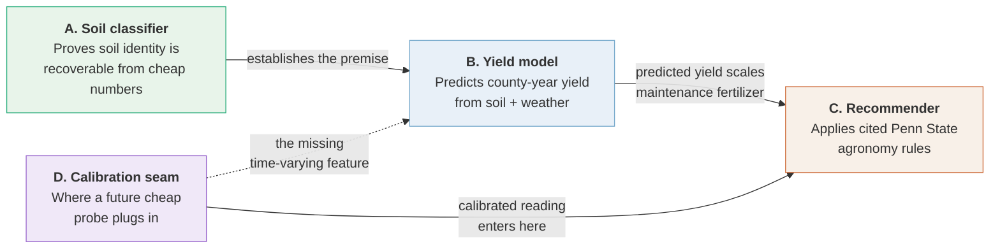

**Why A comes first.** Module A is a *rigor* deliverable, not a product feature.
The entire product rests on one premise: that cheap, measurable soil numbers
(texture, pH, CEC, organic carbon) actually carry soil information. Module A
tests that premise falsifiably — if a model can name a soil's taxonomic order
from those numbers alone, the premise holds. If it couldn't, modules B–D would be
built on sand.

---

## 2. System architecture

The full pipeline, from public web APIs to a printed farm report:

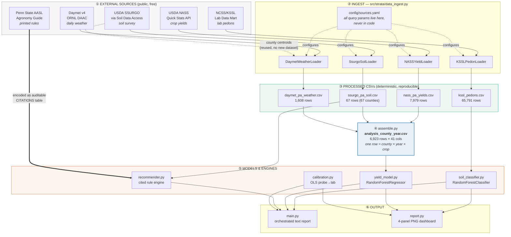

### Design rules enforced throughout

These are not stylistic preferences; each one prevents a specific, named failure.

| Rule | Prevents |
|---|---|
| **Config-driven loaders** — every query parameter is in `config/sources.yaml`, none in Python | Silent, untracked changes to what data was actually pulled |
| **Documented `SCHEMA` per loader** — every output column has a written definition | Ambiguity about what a column means at analysis time |
| **Row-count + missingness logged at every step** | Data thinness being discovered late, or masked by fills |
| **`random_state=42` everywhere** | Non-reproducible results |
| **Secrets from environment only** (`NASS_API_KEY` via `.env`) | API keys in git history |
| **Inner joins with every drop counted and reported** | Silent sample-size loss |
| **Synthetic data always labeled, never reported as a finding** | Fabricated results entering the record |
| **No feature that encodes group identity or a target statistic** | Leakage (§6) |

---

## 3. The data layer: what we gathered and how

Nothing is committed to the repository except the derived processed tables. Every
source is reproducible from the record below.

### 3.1 Provenance table

| # | Source | What we take | Endpoint | Accessed | Auth |
|---|---|---|---|---|---|
| 1 | **USDA NASS Quick Stats** | County-level PA yields, 8 crops, `SURVEY` program, year ≥ 2000 | `https://quickstats.nass.usda.gov/api/api_GET/` | 2026-06-24 | API key |
| 2 | **USDA SSURGO** via Soil Data Access | County topsoil (0–25 cm) texture, pH, OM, CEC + dominant taxonomic order & drainage, 62 PA survey areas → **all 67 PA counties** | `https://sdmdataaccess.sc.egov.usda.gov/Tabular/post.rest` | 2026-07-20 | none |
| 3 | **NCSS/KSSL** Soil Characterization DB | Lab pedon horizons (sand/silt/clay, pH, CEC, organic C) + taxonomic labels, 14 NE/Mid-Atlantic states | SDA Lab Data Mart (`lab_*` tables) | 2026-06-24 | none |
| 4 | **Daymet v4 R1** daily weather | County-centroid daily Tmax/Tmin/precip → growing-season features **+ per-window (Apr-May/Jun/Jul/Aug-Oct) precip & heat-days + a Hargreaves climatic water balance**, 2000–2023 | `https://daymet.ornl.gov/single-pixel/api/data` | 2026-07-24 | none |
| 5 | **Penn State AASL** handbooks | Mehlich-3 P/K, buffer-lime, crop-removal rules | Encoded as a cited rule table, not learned | n/a | n/a |
| 6 | **Open-Meteo Archive (ERA5-Land)** | County-centroid hourly root-zone (7-28 cm) soil moisture → county-year season + per-window means, 2000–2023. *Tested → null (§6, §7); not a shipped feature.* | `https://archive-api.open-meteo.com/v1/archive` | 2026-07-24 | none |
| 7 | **MODIS/061 MOD13Q1 NDVI** via Google Earth Engine | Cropland-masked (USDA CDL) county NDVI, **time-gated ≤ July**, 2000–2023. *Shipped: Jun+Jul (§7).* | `ee.ImageCollection('MODIS/061/MOD13Q1')` | 2026-07-24 | EE account + one-time `earthengine authenticate` |

**Required citation (Daymet data provider):**

> Thornton, M.M., R. Shrestha, Y. Wei, P.E. Thornton, S-C. Kao, and B.E. Wilson.
> 2022. *Daymet: Daily Surface Weather Data on a 1-km Grid for North America,
> Version 4 R1.* ORNL DAAC, Oak Ridge, Tennessee, USA.
> https://doi.org/10.3334/ORNLDAAC/2129

**A note on "citations" in this project.** The word carries two distinct meanings
here, and the paper should keep them separate:

1. **Data provenance** (this section) — where the *training data* came from.
2. **Rule citations** (§8) — where each *agronomic threshold* came from. These are
   attached to individual recommendations at runtime, so every piece of advice the
   product emits names the published rule that justifies it. This is a property of
   the software, not of the paper's bibliography.

### 3.2 How each source is actually fetched

All loaders inherit one abstract contract in `data_ingest.py`:

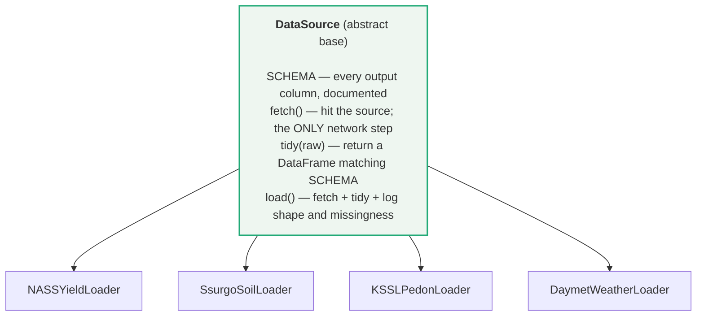

Separating `fetch` from `tidy` means the transformation logic is testable without
a network connection, and the exact request can be printed and audited before it
is ever sent (`build_query_url()` renders the URL with the key masked).

**A practical detail worth recording:** all HTTPS traffic validates against the
**operating-system trust store** via the `truststore` package, not `certifi`'s
bundle. On machines where antivirus or a corporate proxy inspects TLS and re-signs
certificates with a private root, that root is trusted by the OS but absent from
`certifi`, so default `requests` verification fails. Certificate verification
remains **enabled** — it is pointed at the correct store. This is controlled by
`http.use_system_trust_store` in `sources.yaml`.

#### Source 1 — NASS yields (the prediction target)

A single GET per crop. `short_desc` pins NASS's exact series label, which is the
only reliable way to get one well-defined measurement rather than a mixture of
grain/silage or yield/area series. Suppression markers (`(D)`, `(Z)`, `(NA)`) are
coerced to `NaN` rather than to zero — a withheld value is *unknown*, not *none*.

Observed coverage:

| crop | rows | year span | counties |
|---|---:|---|---:|
| corn_grain_yield | 1509 | 2000–2025 | 68 |
| corn_silage_yield | 1204 | 2000–2025 | 68 |
| soybean_yield | 1246 | 2000–2025 | 59 |
| oats_yield | 1234 | 2000–2025 | 63 |
| alfalfa_hay_yield | 927 | 2000–2018 | 67 |
| winter_wheat_yield | 821 | 2000–2025 | 56 |
| hay_yield | 575 | 2000–2008 | 67 |
| barley_yield | 463 | 2000–2015 | 36 |

Two caveats that drive later decisions:

- **NASS thinned several county series over time.** All-hay effectively ends
  ~2008, barley ~2015, alfalfa ~2018 at county level. They are retained for
  history but are not reliable recent targets, and cannot support a
  forward-in-time forecast test.
- **Chester County alone is far too thin to model.** Only 136 rows across all
  crops; just 26 corn-grain county-years. **The yield model therefore trains
  across all PA counties, not Chester alone.** This is stated up front rather than
  discovered later — it is the fundamental granularity limit of county-year data.

#### Source 2 — SSURGO soil (static county context)

Two SQL queries per county survey area, POSTed to Soil Data Access. The
aggregation from raw horizons to one county row is done transparently in pandas
(`SsurgoSoilLoader.tidy`) rather than inside an opaque SQL query, in three
weighting steps:

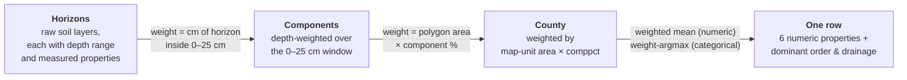

*Stated assumption:* map-unit area weights use `STArea()` in **square degrees**
(the geometry is lat/lon, not projected). Absolute area is irrelevant — only the
*relative* weighting within one county matters, and lat/lon distortion across a
single county is negligible.

*Missing-value discipline:* a property is depth-weighted only over horizons where
that property is non-null, so a missing measurement never drags a component's mean
toward zero.

**Survey areas are not one-to-one with counties.** This is the subtlest part of the
whole ingest, and getting it wrong silently destroyed 10 counties of training data
until 2026-07-20 (see [§14](#14-changelog)). Pennsylvania has 62 SSURGO survey
areas covering 67 counties, because **five areas are joint two-county surveys**:

| areasymbol | areaname | counties (FIPS) |
|---|---|---|
| PA605 | Juniata and Mifflin Counties | 067, 087 |
| PA607 | Cameron and Elk Counties | 023, 047 |
| PA609 | Warren and Forest Counties | 053, 123 |
| PA610 | Bradford and Sullivan Counties | 015, 113 |
| PA611 | Greene and Washington Counties | 059, 125 |

Their areasymbol digits (`605`, `607`, …) are **survey-area codes, not county
FIPS**. Deriving a county by slicing the symbol therefore invents codes that match
no county at all. The authoritative mapping comes from SSURGO's own `laoverlap`
table, which lists the geographic areas each legend overlaps; rows with
`areatypename = 'County or Parish'` carry the real county symbol (`PA067`) whose
last three digits *are* the FIPS. One query returns the whole state
(`SsurgoSoilLoader.area_county_map`), and `load_areas` emits **one row per
constituent county**.

*Stated approximation:* both counties of a joint survey share that survey's single
soil summary, because SSURGO characterized them as one unit and the map-unit
polygons are tagged by survey area, not county. This is a coarser attribution than
a true per-county summary — and it means those county pairs have **identical soil
feature vectors**, so they cannot be told apart by soil alone (they remain distinct
groups for leave-counties-out CV). It is nonetheless strictly better than the prior
behavior of discarding those 10 counties entirely.

#### Source 3 — KSSL lab pedons (trains the soil classifier)

Queried state-by-state across 14 NE/Mid-Atlantic states and stacked, so each
request stays small. The join chain runs across five `lab_*` tables:

```
lab_combine_nasis_ncss   (taxonomic labels + lat/lon + state_key)
  → lab_area              (state_key → postal code, for filtering)
  → lab_layer             (pedon_key → labsampnum + horizon depths)
  → lab_physical_properties   (sand / silt / clay)
  → lab_chemical_properties   (pH, CEC, organic carbon)
```

Result: **65,791 horizon rows / 10,993 pedons**, of which **7,754 carry a soil
order label**.

Two documented recovery decisions:

- **Taxonomic label coalescing:** prefer the *corrected* classification, then SSL,
  then sampled (`corr_taxorder` → `SSL_taxorder` → `samp_taxorder`).
- **CEC method fallback:** `cec_nh4_ph_7` (the standard NH4OAc pH 7 method) is
  ~2/3 empty. Where missing, sum-of-cations pH 8.2 is substituted. This cuts
  layer-level CEC missingness from **66.6% → 36.7%**. The method mix is a real
  limitation and is documented in the column's schema description rather than
  hidden — the two methods are correlated but not identical.

Pedon-level order distribution: alfisols 2627, inceptisols 1874, ultisols 1307,
entisols 806, spodosols 567, mollisols 407, histosols 141, aridisols 19,
vertisols 5, oxisols 1.

**`lat`/`lon` are retained as provenance only and are never classifier features.**
Predicting soil order from coordinates would memorize geography instead of
learning soil science (§5).

#### Source 4 — Daymet weather (the year-to-year driver)

One GET per county centroid returns every day from 2000–2023; `tidy` collapses
those to one row per year. The centroid comes from **reusing SSURGO geometry**
(area-weighted mean of the largest map-unit polygon centroids) rather than adding
a new dataset dependency.

Five features per county-year, over the Apr 1 – Oct 31 growing season
(ydays 91–304, valid every year because Daymet uses a fixed 365-day calendar):

| feature | definition |
|---|---|
| `gdd_base10` | Σ max(0, (Tmax+Tmin)/2 − 10 °C) — accumulated growing-degree-days |
| `precip_total_mm` | Σ daily precipitation |
| `tmax_mean_c`, `tmin_mean_c` | season mean daily max / min temperature |
| `heat_days_30c` | count of days with Tmax ≥ 30 °C (heat stress) |

Result: **1,608 county-year rows** (67 counties × 24 years), no missing values. The
same loader also writes the **per-window** precip/heat-day stats and a Hargreaves
climatic **water balance** into this file; the model selects which of those columns
to use (§6, §7).

*Granularity caveat:* one point represents an entire county. This is coarse for
large or topographically varied counties, but it matches the county-year unit the
yields already use.

*Coverage caveat:* Daymet v4 R1 ends at **2023** while NASS yields run to 2025, so
2024–2025 yield rows have no weather and drop at the join (§4).

---

## 4. Assembly: reconciling three different grains

The three data layers arrive at three different granularities, and reconciling
them is a modeling decision with consequences — every dropped row is a
county-year-crop the model will not learn from. `assemble.py` therefore logs each
step rather than hiding it inside a one-line merge.

| layer | grain | role |
|---|---|---|
| NASS yields | county × year × crop | the prediction **target** |
| SSURGO soil | county (**static** — no time axis) | slow-changing context |
| Daymet weather | county × year | year-to-year driver |

### The join funnel (exact, reproducible counts)

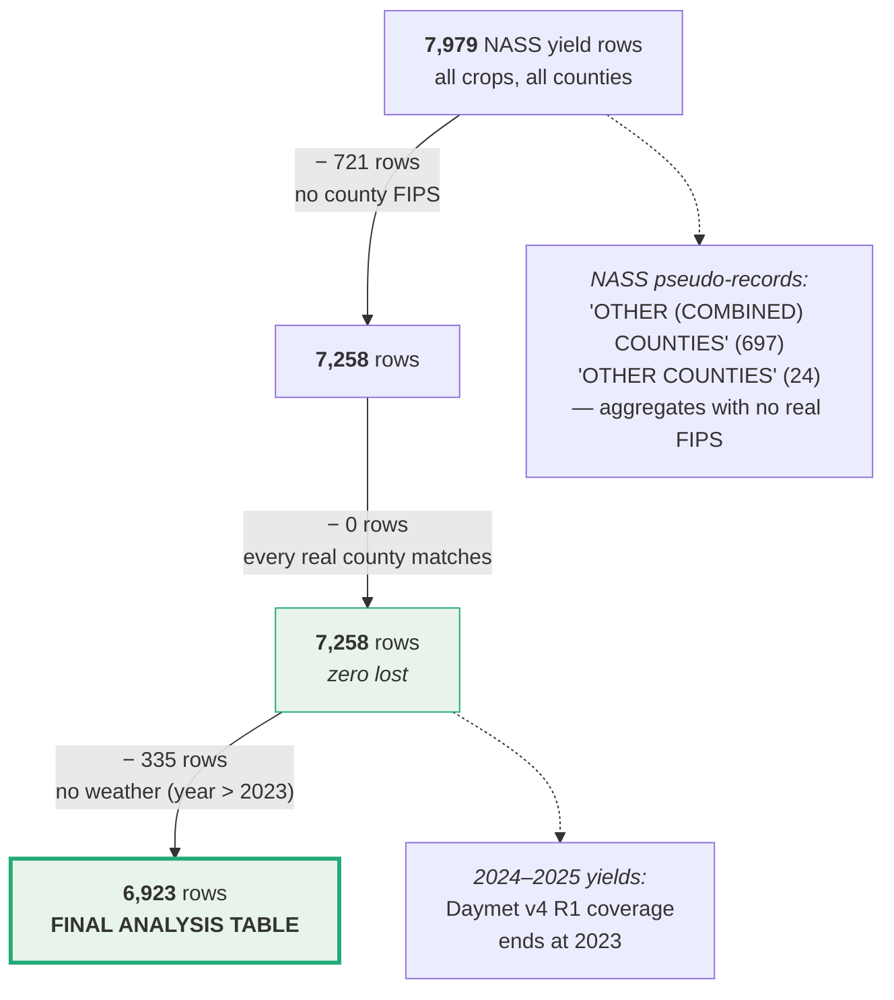

**86.8% of starting NASS rows survive** into the analysis table: 6,923 rows ×
41 columns, covering **66 counties**. Zero rows were lost to yield suppression —
NASS only publishes county yields where disclosure rules allow, so what we receive
is already complete.

The only remaining losses are structural and unavoidable: NASS aggregate
pseudo-records that have no county FIPS by construction, and yield years past
Daymet's 2023 coverage. **The soil join now drops nothing** — before the
multi-county fix it discarded 825 rows and 10 counties.

Final per-crop training set sizes:

| crop | rows | counties | years |
|---|---:|---:|---|
| corn_grain_yield | 1314 | 66 | 2000–2023 |
| oats_yield | 1089 | 61 | 2000–2023 |
| corn_silage_yield | 1044 | 66 | 2000–2023 |
| soybean_yield | 1033 | 57 | 2000–2023 |
| alfalfa_hay_yield | 843 | 66 | 2000–2018 |
| winter_wheat_yield | 667 | 54 | 2000–2016 |
| hay_yield | 567 | 66 | 2000–2008 |
| barley_yield | 366 | 35 | 2000–2015 |

One row of the final table looks like:

```
(county, year, crop, YIELD)
  + [8 static soil features]
  + [that-year weather: 5 season aggregates + per-window precip & heat-days]
  + [that-year NDVI: cropland-masked Jun & Jul, time-gated]     <- shipped 2026-07-24
  + [tested-null layers carried for audit: water balance, ERA5-Land soil moisture]
```

Identifier columns (`county_ansi`, `county_name`, `areasymbol`) ride along for
traceability but are **never** model features.

---

## 5. Module A — Soil classifier

**Question it answers:** *Is soil identity genuinely recoverable from cheap,
measurable numbers?*

This is a falsifiable test of the premise underlying the whole product. It is
**not** a product feature.

### Setup

- **Target:** Soil Taxonomy ORDER (alfisols, ultisols, inceptisols, entisols,
  spodosols, mollisols, histosols).
- **Model:** `RandomForestClassifier`, 400 trees, `class_weight="balanced"` so
  large classes don't swamp valid rare ones.
- **Training data:** 7,686 labeled pedons.
- **Excluded classes:** aridisols (19 pedons), vertisols (5), oxisols (1) — too
  rare to learn *or* validate. A 1-pedon class cannot appear in both a train and a
  test fold. **This decision is made visibly in the classifier, not hidden in
  ingest.**

### Feature engineering: from layers to profiles

Lab data arrives layer-level (one row per horizon), but soil order is a
**whole-profile** property. `engineer_pedon_features` collapses each pedon's
horizons into one row of 19 features in three groups:

| group | features | what it captures |
|---|---|---|
| `surf_*` | sand, silt, clay, pH, CEC, organic C — depth-weighted over 0–25 cm | the epipedon (surface horizon) |
| `prof_*` | the same six, depth-weighted over the whole profile | overall soil chemistry and texture |
| diagnostic | `clay_max`, `clay_increase`, `ph_min`, `ph_max`, `oc_max`, `solum_depth`, `n_horizons` | **depth contrast** — the diagnostic subsurface horizons taxonomy actually keys on |

`clay_increase` (maximum subsoil clay − surface clay) is the deliberate encoding
of an **argillic horizon**: clay translocated downward and accumulated in the
subsoil, which is precisely the criterion separating alfisols and ultisols from
inceptisols.

### Leakage discipline

- `lat`/`lon` **dropped** — coordinates would let the model memorize geography.
- `tax_greatgroup` / `tax_subgroup` **dropped** — they are *finer labels of the
  same taxonomy as the target* and would leak the answer directly.
- Imputation sits **inside** the `Pipeline`, so the median is fit per training
  fold and test statistics never leak in.

### Results

| metric | value |
|---|---|
| 5-fold stratified CV accuracy | **0.698 ± 0.009** |
| 5-fold stratified CV macro-F1 | **0.648 ± 0.014** |
| majority-class baseline | **0.341** |

> This module is **unaffected** by the SSURGO fix — it trains on KSSL lab pedons,
> not SSURGO, and `kssl_pedons.csv` was not regenerated. The values above are a
> fresh 2026-07-20 measurement; they differ marginally from the 2026-06-24 record
> (0.689 / 0.653) despite a fixed seed and identical input, which indicates a
> library-version difference between the two runs rather than a data change. The
> current numbers are the ones to cite.

The model roughly **doubles** the baseline. Per-class held-out F1: alfisols 0.79;
ultisols / spodosols / inceptisols ≈ 0.66–0.68; histosols and mollisols weakest
(≈ 0.52, confused mainly with alfisols).

**The most important result is *which* features matter.** The top
permutation-importance features are **`clay_increase` and `clay_max`** — followed
by profile CEC, organic carbon, and pH. That is the argillic-horizon signal that
Soil Taxonomy formally keys on. The model recovered real soil science from the
numbers rather than latching onto an artifact. Because coordinates were excluded,
this cannot be geographic memorization.

**Conclusion: the premise holds.** Cheap measurable numbers carry genuine soil
information, which is what licenses modules B–D.

> **Honest framing for the paper.** Published digital-soil-mapping studies report
> higher accuracies (often 0.85+), but they are solving a *different and easier*
> problem: they typically include terrain, climate, and spatial covariates, and
> often predict fewer classes. Strata deliberately excludes every spatial covariate
> because the question here is *"do the lab numbers alone carry the signal?"* —
> not *"what is the highest achievable soil-mapping accuracy?"* These numbers should
> not be presented as competitive with DSM literature; they answer a narrower question.

---

## 6. Module B — Yield model

**Question it answers:** *How well can county-year yield be predicted from soil
and weather — honestly?*

The word **honestly** is doing real work here, and it is the module's main
methodological contribution.

### Why one model per crop

Yield units differ by crop — corn/soy/wheat/oats/barley are BU/ACRE, silage and
hay are TONS/ACRE — and magnitudes differ by an order of magnitude. Pooling them
would make MAE and R² meaningless. Every reported number is in that crop's own
units.

### Leakage discipline

| Rule | Why |
|---|---|
| County identity is **never** a feature | The model must generalize from agronomy, not memorize which county a row came from |
| **No per-group target statistic** (e.g. county mean historical yield) | That leaks the answer directly |
| `year` is an **explicit, switchable** term, never a hidden feature | Its contribution must be measurable, not smuggled in |
| Imputation inside the `Pipeline` | Fit per training fold only |

### Two modes: attribution vs forecast

PA corn and soy county yields carry a strong upward trend over 2000–2023.
*Measured in this data: **2.08 bu/acre/year***, attributable to improved hybrids
and management. That is real signal — but it is not a soil or weather effect. So
rather than silently choosing, both treatments are reported:

| mode | `include_trend` | `year` | question it answers |
|---|---|---|---|
| **Attribution** | `False` | withheld | "How much do soil + weather *alone* explain?" — the conservative number |
| **Forecast** | `True` (**product default**) | included | "What will this field actually yield?" — what a farmer needs |

### Three validations, deliberately layered

This is the core of the module. Each split answers a different question, and the
*gaps between them* are the finding.

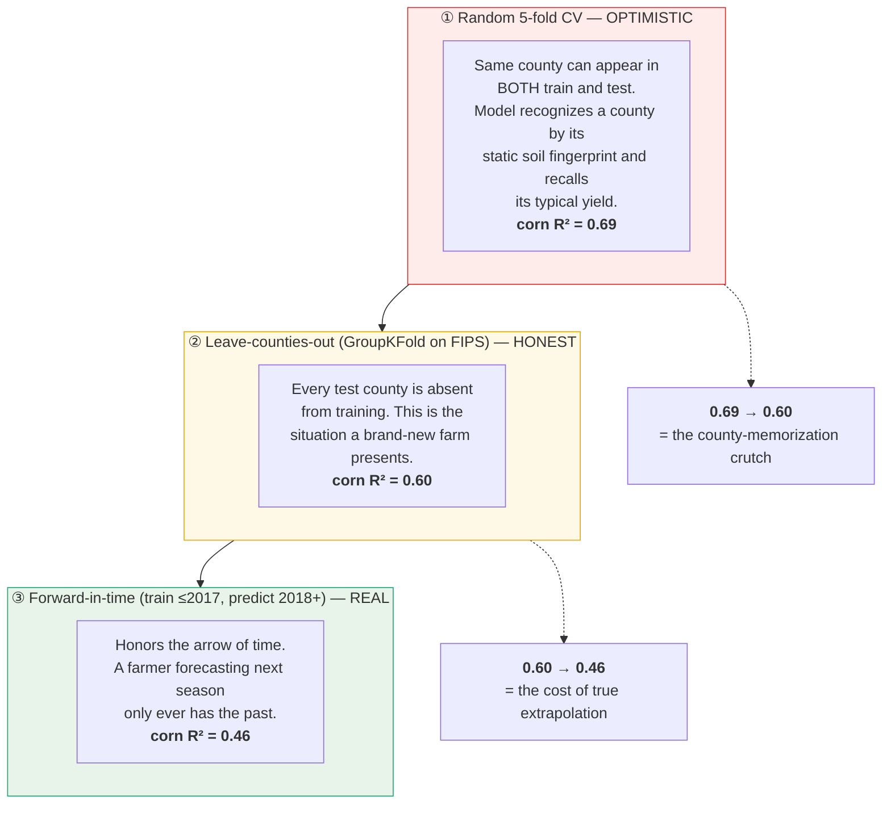

**Why the random-CV number is misleading.** Soil features are county-*static*:
every row from a county shares the same 8 soil values. Under random k-fold the
model can identify a county by that fingerprint and recall its average yield —
which is memorization, not agronomy. The drop from 0.69 to 0.60 quantifies how
much it leans on that crutch on the *current* feature matrix.

> **This is corroborated by the literature — with a nuance the new features add.**
> Published work on spatial leakage in yield modeling finds that within-region random
> cross-validation inflates performance by **0.22–0.38 R² units** relative to
> leave-one-region-out evaluation, and recommends leave-one-region-out (or spatial
> block CV) as the default protocol. On the leaner soil-plus-season-weather matrix
> Strata's inflation was **0.17** (0.68 → 0.51), squarely in that range. Adding the
> generalizable time-varying features (NDVI especially) **narrows the raw gap to 0.09**
> (0.69 → 0.60) — not because the fingerprint effect disappeared, but because a real
> within-county signal now lifts the *honest* score more than the optimistic one. The
> crutch is still visible per-feature: the static soil importances roughly halve from
> random → leave-counties-out (below), exactly where the mechanism predicts.

### Headline results — corn grain (1,314 county-years, 66 counties)

| evaluation | MAE (bu/ac) | R² |
|---|---:|---:|
| mean-yield baseline (held-out) | 22.8 | ~0.00 |
| attribution, leave-counties-out (soil + weather + NDVI, no trend) | 15.3 | 0.512 |
| **forecast, leave-counties-out (+ trend)** | **13.6** | **0.601** |
| forecast, forward-in-time (train ≤2017, predict 2018+) | 14.6 | 0.461 |
| same forward test **without** trend | 19.4 | **0.086** |

**The last row changed meaning when NDVI was added, and the change is itself a
finding.** On the old soil-plus-season-weather matrix, a model that withheld the
trend and forecast forward scored **−0.42** — *worse than guessing the average* —
because nothing in it could see the yield level rising year over year. Adding the
time-varying features — sub-season weather and, above all, a satellite NDVI
*observation* of the actual crop — lifts that same no-trend forward forecast to
**+0.086**: NDVI directly measures how the crop is doing, so it recovers much of the
level the trend used to carry alone. The trend term still earns a large
lift (forward R² 0.086 → 0.461; MAE 19.4 → 14.6), so it stays in the product default —
but the once-catastrophic no-trend result is now merely weak, and *why* it improved
is a clean corroboration of the ceiling thesis (§7): an independent, time-varying
observation carries real within-county information.

### All crops

| crop | rows | counties | unit | attrib R² | forecast R² | forward R² | fcst MAE | ship? |
|---|---:|---:|---|---:|---:|---:|---:|:--:|
| corn_grain_yield | 1314 | 66 | BU/ACRE | 0.512 | 0.601 | 0.461 | 13.6 | ✓ |
| oats_yield | 1089 | 61 | BU/ACRE | 0.127 | 0.166 | −0.093 | 6.3 | ✗ |
| corn_silage_yield | 1044 | 66 | TONS/ACRE | 0.511 | 0.553 | 0.571 | 1.8 | ✓ |
| soybean_yield | 1033 | 57 | BU/ACRE | 0.511 | 0.581 | 0.456 | 4.0 | ✓ |
| alfalfa_hay_yield | 843 | 66 | TONS/ACRE | 0.255 | 0.254 | 0.002 | 0.4 | ✗ |
| winter_wheat_yield | 667 | 54 | BU/ACRE | 0.177 | 0.318 | — | 6.6 | ✓ |
| hay_yield | 567 | 66 | TONS/ACRE | 0.401 | 0.408 | — | 0.3 | ✓ |
| barley_yield | 366 | 35 | BU/ACRE | 0.251 | 0.283 | — | 7.3 | ✗ |

(— = the NASS series ends before 2018, so no forward split exists.)

**Stated plainly: `oats` (0.17) and `alfalfa` (0.25) remain essentially unexplained
by the features, and `barley` (0.28) falls just under the bar.** This is surfaced,
not masked, and drives the product gate (§10). Note two shifts from the pre-NDVI
figures: the headline crops' honest forecast R² rose with the time-varying features
(corn 0.51 → 0.60, soy 0.51 → 0.58, silage 0.44 → 0.55), and **winter wheat (0.318)
crossed the 0.30 gate**, moving from withheld to shipped. Not everything went up:
`barley` slipped to 0.283 (0.376 → below the gate), mostly because the SSURGO fix
added two harder, previously-missing counties to its small 35-county panel — an
honest, expected consequence of a stricter test, not a regression to hide.

### Negative results (tested and rejected)

Recorded because null results are findings, and because they support the ceiling
argument in §7:

| tried | outcome |
|---|---|
| Gradient boosting, ExtraTrees | Did not beat RF + trend on forward forecast |
| Hyperparameter tuning | No improvement |
| County lat/lon as features | No improvement |
| Engineered weather × soil interactions | No improvement |
| ExtraTrees specifically | **Raised** leave-counties-out R² while **lowering** forward R² — a mirage we declined to ship |
| Explicit linear detrend (linear trend + RF on residual) | **Slightly hurt** forward forecast (corn 0.35 → 0.29, measured on the pre-NDVI matrix). The linear trend *overshoots* on 2018+, while year-in-RF holds near its terminal-year level and was already closer. Kept as a finding rather than tuned away. |
| **Water-balance drought index** (precip − Hargreaves PET), added 2026-07-24 | **~0 gain** on top of the weather windows + NDVI. It is derived from the *same* precip/temperature the model already has, so it is not independent information. |
| **ERA5-Land soil moisture** (Open-Meteo), added 2026-07-24 | **~0 gain**, and it *lowered* winter-wheat forecast skill. Same reason: a reanalysis modeled from the same meteorology, redundant with the weather features. |
| Per-window mean-temp/GDD, and the Apr-May NDVI window | Pruned as **forward-forecast noise** — collinear with the season means / pre-emergence bare soil. |

The detrend result deserves note: it was motivated by a legitimate theoretical
concern — a RandomForest cannot extrapolate `year` beyond its training range. The
concern is correct, but the empirical consequence was the opposite of predicted,
because holding flat at the terminal level happens to beat linear extrapolation
over this horizon.

### Permutation importance, and a corrected error

Permutation importance is computed **leave-counties-out** and averaged across
folds, keyed on the **raw input columns**.

> **A correction that is part of the record.** An earlier version of this analysis
> reported a headline result of `dominant_taxorder ≈ 0.89` importance. That was a
> **label/column misalignment bug**: importances were being labeled with the
> `ColumnTransformer`'s post-one-hot names, which differ in length and order from
> the raw input columns. That 0.89 magnitude actually belongs to **`year`**, the
> trend term. Correctly labeled, taxorder is minor in *both* splits (~0.004). The
> bug and its correction are documented rather than quietly overwritten.

Correctly computed on the current matrix, the ranking is led by the two
**time-varying** terms — `year` (the trend, ~0.44 in both splits) and **`ndvi_jul`**
(the satellite crop observation, ~0.23 in both splits, the strongest non-trend
feature). Beneath them the honest signal comes from within-season weather timing
(`precip_jul` ~0.03, `heat_days_jul`, `ndvi_jun`). By contrast the **static soil
numerics shrink from random → LCO** exactly as the ceiling predicts: `topsoil_om`
0.099→0.054, `cec` 0.029→0.008, `ph` 0.011→0.005, `clay` 0.009→~0.000. That
shrinkage *is* the county-recall crutch; the fact that `year` and `ndvi_jul` **hold**
across splits while soil **shrinks** is the per-feature fingerprint of the §7
argument — time-varying features generalize, static ones memorize.

---

## 7. The central finding: a feature-information ceiling

This is the strongest intellectual contribution of the project, and the section a
paper should build around. **It has been independently re-derived from the data
during preparation of this document.**

### The claim

Strata's honest performance is **not a model-tuning limitation. It is a hard
information limit of the feature matrix.** No estimator can extract signal that the
features do not contain. The soil-plus-season-weather matrix hit a ceiling at
LCO R² ≈ 0.53 / forward ≈ 0.28; we then *moved* that ceiling to forward ≈ 0.46 — but
only, and exactly, by adding features that vary **within a county over time** (the
test below). The structural claim stands: static soil can never touch the
within-county share, so the lever is always a time-varying feature.

### The derivation

Decompose corn yield variance into between-county and within-county components:

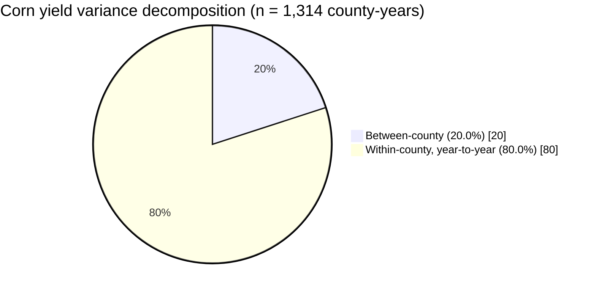

Now the decisive observation:

> **The 8 SSURGO soil features are static per county — one value per county, no
> time axis. Their within-county variance is *exactly zero*, verified directly in
> the data.**

Therefore:

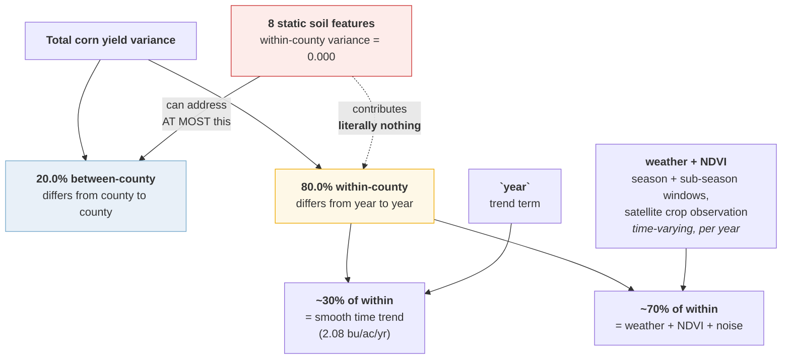

**In words, for a non-technical reader:** four-fifths of the reason one corn
harvest differs from another is that *years* differ, not that *places* differ. But
every soil number we have is a single fixed snapshot per county — it is the same
value in 2003 and 2019. A number that never changes cannot possibly explain
something that changes every year. So all eight soil features are competing for
at most a fifth of the problem, and the other four-fifths rests entirely on the
*time-varying* inputs: the county-centroid weather (now split into sub-season
windows), the satellite NDVI observation of the crop, and a straight-line trend.

That is why honest R² sits near 0.5–0.6 and not 0.9. It is not that we chose the
wrong algorithm — and the only way up is *more* time-varying signal, which is
exactly what the test in the next subsection adds.

### Why this matters methodologically

This reframes an apparently mediocre result into a precise, quantitative
statement about what the data can and cannot support. It converts *"our model
isn't very good"* into *"here is the exact information budget, here is the share
each feature class can address, and here is what a new feature would have to look
like to improve it."*

It also produces a **falsifiable prediction**: the only way to improve materially
is a feature that varies **within a county over time**. Every negative result in
§6 is consistent with this — none of the rejected approaches added such a feature,
so none of them helped. That is exactly what the theory predicts, which is a
non-trivial corroboration.

And it gives the hardware roadmap a *derived* justification rather than an assumed
one (§9).

### The prediction, tested — and confirmed (2026-07-24)

The prediction above is falsifiable, so we tested it directly by adding four free,
**within-county time-varying** public sources and measuring each against the same
honest leave-counties-out **and** forward-in-time splits (headline crop, corn grain):

| feature matrix | LCO forecast R² | forward-in-time R² | forward MAE |
|---|--:|--:|--:|
| soil + season-aggregate weather (the ceiling above) | 0.53 | 0.28 | 17.2 bu |
| + sub-season **weather windows** (precip & heat-days) | 0.57 | 0.39 | 16.0 bu |
| + **MODIS NDVI** (cropland-masked, Jun+Jul, time-gated) | **0.61** | **0.46** | **14.6 bu** |

**The prediction held in both directions**, which is the strongest form of corroboration:

- **Within-county time-varying features moved the ceiling**, exactly as predicted. Sub-season
  weather *timing* (a July silking-window drought a season total hides) lifted forward R²
  0.28 → 0.39; a satellite NDVI *observation* of the crop lifted it further to 0.46. Static
  soil still contributes nothing to the within-county share — the derivation stands; the gains
  come entirely from the new time-varying axis.
- **Two time-varying sources that were NOT independent added nothing** — a water-balance drought
  index and ERA5-Land soil moisture (both reanalyses derived from the same precip/temperature)
  were ~0 gains (soil moisture *hurt* wheat). This refines the prediction: the feature must be
  time-varying **and carry information independent of the meteorology already present.**

This is the empirical payoff of naming the ceiling: it told us precisely what to add, we added
it, and the honest forward forecast rose from 0.28 to 0.46 on free public data alone. The residual
gap is now a *derived specification for the probe* (§9): the remaining independent, time-varying,
soil-specific signal that no county-mean reanalysis can supply.

---

## 8. Module C — Recommendation engine

**Question it answers:** *What should this farmer actually do to their soil?*

### Why a rule engine and not a model

Fertility and lime recommendations are a **solved, regulated agronomy problem**
with decades of controlled calibration trials behind the published thresholds.
Re-learning them from observational county-year yield data would be:

1. **Circular** — the yield data was itself produced by farmers already following
   these recommendations.
2. **Less trustworthy** — extension guidance is field-calibrated; our observational
   fit would not be.
3. **Unnecessary** — the rules are published and free.

So `OptimizationEngine` is a **transparent lookup**, not a learned model. It also
explicitly replaced an earlier circular "IQR scorer," which has been removed.

### Rules encoded

| rule | thresholds | source |
|---|---|---|
| **Lime / pH** | target pH ≈ 6.0 general crops; ≈ 6.5–6.8 legumes | Penn State Agronomy Guide, *Soil Acidity and Liming* |
| **Lime rate** | derived from Mehlich **buffer pH**, not water pH | Penn State AASL buffer-pH method |
| **Phosphate (P₂O₅)** | below optimum <30 ppm; optimum 30–50; above 50–200; excessive >200 (P-Index concern) | Penn State AASL Mehlich-3 P interpretation |
| **Potash (K₂O)** | below optimum <100 ppm; optimum ~100–130; above >130 | Penn State AASL Mehlich-3 K interpretation |
| **Maintenance rates** | corn grain ~0.37 lb P₂O₅ and ~0.27 lb K₂O per bushel; soybean ~0.80 / ~1.30 | Penn State / IPNI crop removal coefficients |

Every threshold lives in one auditable `CITATIONS` table with named constants, so
a wrong value is correctable in one place rather than scattered through
arithmetic. Every emitted recommendation prints: the **measured value**, the
**threshold it crossed**, the **action**, an **amount** where defensible, and the
**citation**.

### Input honesty — the design's sharpest edge

SSURGO carries pH, CEC, OM and texture, but **does not carry Mehlich-3 P/K or
buffer pH**. Those come only from a real lab test of the specific field.

**The engine therefore refuses to interpret P/K when they are absent**, returning
an explicit *"obtain a Mehlich-3 soil test"* item rather than guessing:

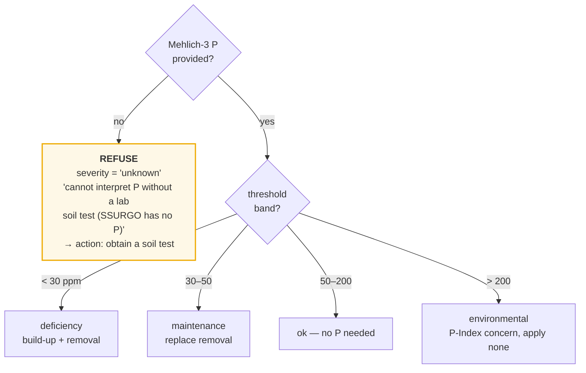

The same applies to lime: with only SSURGO water pH and no buffer pH, the engine
states that **a rate is not derivable** and a buffer-pH test is required, rather
than inventing a tonnage. When buffer pH *is* supplied, the printed rate is
labeled a clearly-marked **ESTIMATE** to be confirmed against the AASL table.

This refusal behavior is, arguably, the product's most valuable property: it
encodes the boundary between county-scale context and field-scale measurement —
the same gap the calibration seam is designed to close.

### The one place two modules compose

Maintenance fertilizer replaces what the harvest removes, so the rate must scale
with expected harvest size. The basis is chosen in strict priority order:

1. A **YieldModel-predicted yield**, when supplied (`recommend(..., expected_yield=...)`)
2. Else the farmer's **stated yield goal**
3. Else **no rate at all** — never fabricated

The printed rate **names which basis it used**, so a model estimate is never
passed off as a measured target. And the handoff is **gated** — `main.py` only
feeds a predicted yield when that crop cleared the product quality gate (§10).

Crucially, `expected_yield` **never** relaxes the input-honesty rule: a missing
lab test still returns "obtain a soil test," predicted yield or not.

---

## 9. Module D — Calibration seam

**Question it answers:** *Where would a cheap soil probe plug in, and what would
it actually buy us?*

### The contract

`ProbeCalibration` fits a per-property ordinary least squares mapping from paired
`(probe_reading, lab_value)` samples:

```
lab_equivalent = slope × probe_reading + intercept
```

and reports its quality: slope, intercept, R², RMSE, and `mean_bias` — the raw
uncalibrated probe−lab offset that calibration exists to remove. A raw reading is
then mapped to a lab-equivalent value and fed into **the same recommender**.
Nothing upstream changes.

The fit is deliberately a simple straight line. With the handful of paired samples
a farmer would realistically collect, a one-parameter-per-axis correction is
honest; anything more flexible would overfit a tiny calibration set.

### Why this is the *derived* next step, not an assumed one

This is where §7 pays off. The ceiling exists because **no feature in the matrix
varies within a county over time**. A probe reading taken at a specific field in a
specific season is exactly that missing axis: a **time-varying soil measurement**.

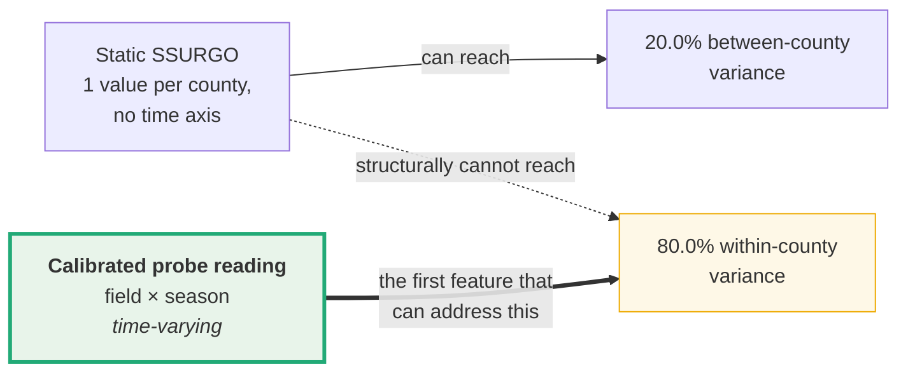

So the seam is where genuinely **new predictive signal** would enter — not merely
finer spatial resolution. That is a much stronger argument for the hardware than
"more data is better," and it is quantified.

> **Sharpened by the 2026-07-24 results (§7).** We since added free *time-varying*
> public data and it worked — weather windows + NDVI moved the forward forecast
> 0.28 → 0.46. Crucially, two free *gridded soil* proxies (a water-balance drought
> index and ERA5-Land soil moisture) added **nothing**, because they are reanalyses
> derived from the same county weather the model already has. That null is the
> precise argument for the probe: the remaining signal must be **time-varying AND
> independent of the meteorology** — i.e. an *actual field soil measurement* (water
> status, drainage, compaction, management), which is exactly and only what a probe
> reading through this seam provides. The gridded proxies confirmed the mechanism and
> mapped its limit; the probe is what crosses it.

### Honesty

**No probe exists and no real probe data exists.** The demo fits on a
clearly-labeled **synthetic** paired sample (a known gain/offset/noise applied to
real lab values) purely to exercise the interface. Per project rule, synthetic
output is labeled and **never** reported as a finding. It demonstrates that the
seam works, not that any probe is accurate.

**Strata has zero dependency on hardware.** Modules A, B, and C all run today with
no sensor. The probe is an optional accuracy layer, not a prerequisite.

### 9.1 Probe channel registry (`probe.py`) — placeholder

**Status: contract only.** As of 2026-08-31 the team has acquired the final sensor
suite, so *what* the device measures is settled; *what it emits* is not. Rather
than write a parser against a guessed serialization, `probe.py` records the
settled part — how each channel is allowed to travel through the system — and
raises `NotImplementedError` for the rest. Nothing in the pipeline imports it, and
`tests/test_probe_placeholder.py` enforces that.

The registry's load-bearing decision is `lab_scale`, which determines a channel's
destination:

| channel | sensor | lab scale | destination |
|---|---|---|---|
| `soil_moisture` | SEN0193 capacitive | — | yield model |
| `soil_temp` | DS18B20 | — | yield model |
| `ph` | pH probe | water pH | both |
| `nitrogen` | NPK sensor | — | yield model |
| `phosphorus` | NPK sensor | Mehlich-3 P *(unvalidated)* | both |
| `potassium` | NPK sensor | Mehlich-3 K *(unvalidated)* | both |
| `co2` | SCD40 | — | yield model |

A channel with **no lab scale can never reach the rule engine**, because §8's
thresholds are defined against specific laboratory measurements; comparing a raw
sensor number to one would emit a cited-looking recommendation that is not real.
Three consequences follow, each of which is a test:

- **CO₂ can never be a recommendation.** It is the project's differentiator and
  therefore the most tempting channel to overclaim, but no AASL threshold exists
  for soil respiration. It is a yield-model feature and a trend shown to the
  farmer, nothing more.
- **Nitrogen is not a recommendation input.** Penn State's corn N guidance is the
  PSNT pre-sidedress nitrate test, which this sensor does not perform.
- **P and K claim a Mehlich-3 scale they have not yet earned.** A
  conductivity-style NPK probe performs no Mehlich-3 extraction, so any mapping is
  an empirical correlation onto that scale, not the same measurement. Until paired
  lab samples validate it with an honest R², §8's "obtain a soil test" refusal
  stands, and the claim carries a CAUTION in the registry.

A calibrated pH refines the lime **trigger**, but buffer pH is a separate
laboratory titration no field probe performs, so §8 will still decline to state a
lime **rate**. That refusal is intended and is tested.

**The open question, recorded before any number depends on it.** `readings_to_
features` — the function that would actually address §7's ceiling — is blocked on
a granularity decision the data must settle. The yield model is trained on
county-year rows against a NASS county mean; probe readings are field-scale, and
one probe in one field is not a county mean. Aggregation alone cannot fix this
without fabricating representativeness. The two candidate resolutions are (1)
keep the county-year model as the backbone and treat probe features as a
documented field-level adjustment on top of its prediction, or (2) move to a
field-year model, which requires field-level yield truth Strata does not have.
**Whichever is chosen must be recorded here before any result derived from it is
reported.**

---

## 10. Orchestration and the product quality gate

`main.py` sequences all four capabilities into one report, running **fully
offline** from `data/processed/*.csv` — no API key or network needed.

### The product quality gate

A research paper reports every crop. A *product* must not hand a farmer a number
they would wrongly trust. `YieldModel.PRODUCT_MIN_FORECAST_R2 = 0.30` is the named,
auditable threshold on the **honest leave-counties-out forecast R²**:

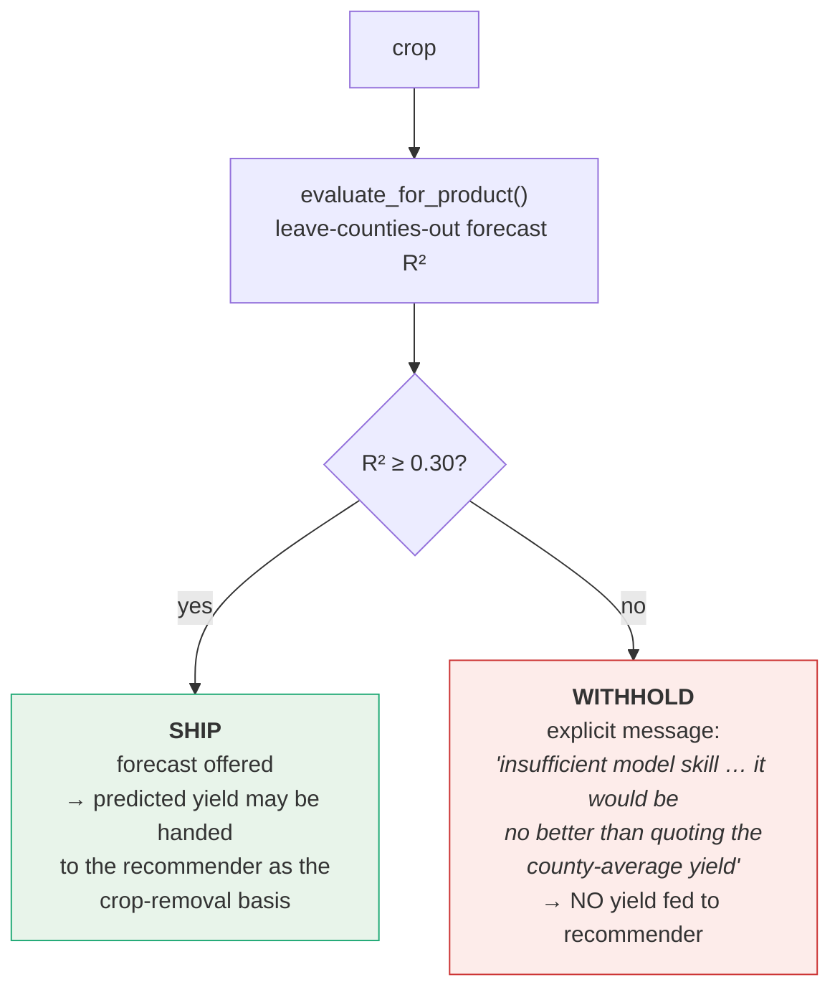

| crop | LCO forecast R² | decision |
|---|---:|---|
| corn_grain_yield | 0.601 | **SHIP** |
| soybean_yield | 0.581 | **SHIP** |
| corn_silage_yield | 0.553 | **SHIP** |
| hay_yield | 0.408 | **SHIP** |
| winter_wheat_yield | 0.318 | **SHIP** (newly clears the gate) |
| barley_yield | 0.283 | **WITHHOLD** |
| alfalfa_hay_yield | 0.254 | **WITHHOLD** |
| oats_yield | 0.166 | **WITHHOLD** |

The threshold of 0.30 is a **judgment call**, and the paper should present it as
one: it is the point at which a forecast becomes usefully better than quoting the
county mean. What matters methodologically is not the specific value but that it
is (a) named, (b) in one place, (c) applied to the *honest* metric rather than the
flattering one, and (d) separates the research surface from the product surface
rather than conflating them.

### Figures available for the paper

`python -m strata.report` renders `data/processed/strata_dashboard.png`:

| panel | content | what it demonstrates |
|---|---|---|
| **A** | Predicted vs actual corn yield, leave-counties-out | Honest predictive performance on unseen counties |
| **B** | Accuracy ladder: baseline → attribution → forecast → forward → forward-no-trend | The trend term is the single biggest lift; on the current matrix the no-trend forward forecast is now weakly positive (NDVI recovers much of the level it used to miss) |
| **C** | Soil classifier confusion matrix (normalized) | Soil order *is* readable from lab numbers |
| **D** | Synthetic probe→lab calibration fit | The hardware seam, honestly labeled |

Diagrams in this document are Mermaid and render directly in GitHub and VS Code;
for print, export via the Mermaid Live Editor or `mermaid-cli`.

---

## 11. Impact, contribution, and relation to prior work

### The honest positioning

Strata's headline predictive numbers are **not** state of the art, and the paper
should not claim they are. County-level yield prediction using richer inputs —
satellite vegetation indices, crop simulation model outputs, high-resolution
gridded weather, deep architectures — achieves substantially better skill.

**The contribution is methodological, not a performance record.** Specifically:

### Contribution 1 — Quantifying the honest-evaluation gap on a real system

Most applied ML agriculture projects — especially student and portfolio projects —
report random k-fold cross-validation on spatially structured data. Strata
demonstrates on real USDA data that this inflates corn yield R² — by **0.17 units
(0.51 → 0.68)** on the soil-plus-season-weather matrix, and still **0.09 (0.60 → 0.69)**
on the full shipped matrix — and it identifies the precise mechanism: county-static
soil features act as a fingerprint that lets the model recognize a county and recall
its typical yield.

This is consistent with published findings that within-region random CV inflates
performance by 0.22–0.38 R² units relative to leave-one-region-out evaluation, and
that spatially-aware CV should be the default protocol. Strata's value here is as a
**complete, reproducible worked example** of the diagnosis — including
leave-counties-out permutation importance showing *which specific features* carry
the leakage, which is less commonly reported than the headline gap.

### Contribution 2 — The feature-information ceiling as a named, derived quantity

This is the most novel element. Rather than reporting a mediocre R² and
speculating about improvements, Strata derives *why* the ceiling sits where it
does:

- 20.0% / 80.0% between vs within-county variance decomposition
- static features have provably **zero** within-county variance
- therefore soil features address at most ~20% of the problem, structurally
- the remaining ~80% splits into a ~30% smooth trend and ~70% weather + noise
- time-varying inputs (weather windows + satellite NDVI + the trend) are all that
  address the latter — and adding them is what moved the honest forward forecast
  from 0.28 to 0.46 (§7)

This converts "the model plateaus" into a **quantitative information budget** with
a falsifiable prediction: only a within-county, time-varying feature can help. That
prediction was then **tested in both directions** (§7): six modeling alternatives
that added no time-varying signal all failed, *and* two free time-varying sources —
sub-season weather windows and satellite NDVI — moved the honest forward forecast
0.28 → 0.46, while two *non-independent* time-varying reanalyses (a drought index and
ERA5-Land soil moisture, both derived from the same meteorology) added nothing. The
budget didn't just explain the plateau; it correctly predicted what would and would
not raise it. Framing model limits as an information budget rather than a tuning
problem is uncommon in applied agricultural ML papers and is the finding most worth
foregrounding.

### Contribution 3 — Refusal as a designed product behavior

Two mechanisms encode "we don't know" as a first-class output:

- The **recommender refuses** to interpret P/K without a lab test, rather than
  imputing from county context.
- The **product gate withholds** yield forecasts for crops below a named skill
  threshold, with an explicit insufficient-skill message.

Most published ML-agriculture work reports metrics for every crop and every
condition; comparatively little formalizes *when the system should decline to
answer*. For a tool aimed at small farms — where a wrong fertilizer rate is a real
financial and environmental cost — the decision boundary between "here is a
number" and "get a soil test" is arguably more important than the R².

### Contribution 4 — Hybrid learned/cited architecture

Strata deliberately **does not learn** what is already solved. Yield prediction is
learned (it is genuinely a prediction problem); fertility recommendations are a
cited rule engine (a solved, calibrated, regulated problem). Each recommendation
carries a runtime citation to its source rule.

This matters for adoption: an extension agronomist can audit the entire
recommendation surface line by line without evaluating a model. Many end-to-end ML
agriculture systems learn recommendations directly from observational data, which
is circular (the training yields were produced under those same recommendations)
and unauditable.

### Contribution 5 — Reproducibility and negative-result discipline

- Every source reproducible from a provenance record; nothing bulk-committed.
- Fixed seeds throughout; deterministic sort order; byte-stable outputs.
- Every join drop counted and reported (86.8% survival rate stated).
- **Negative results retained as findings** — six rejected approaches, including
  one (linear detrend) motivated by correct theory that empirically backfired.
- **A discovered analysis bug documented with its correction** rather than
  silently fixed (the `dominant_taxorder ≈ 0.89` mislabeling, §6).

### Where Strata is genuinely weaker than prior work

State this plainly in the paper:

| dimension | Strata | typical published work |
|---|---|---|
| Predictive skill | corn LCO R² 0.60 / forward 0.46 | 0.7–0.9+ with satellite/simulation inputs |
| Spatial resolution | county | field or sub-field |
| Soil classification | 0.698 (lab features only) | 0.85+ with terrain/climate covariates |
| Inputs | ~23 features, free public data | dozens, often including commercial imagery |
| Geographic scope | Pennsylvania | multi-state or national |

The correct framing is: **Strata trades predictive ceiling for auditability,
zero cost, and calibrated honesty** — and then *measures and reports exactly what
that trade costs*, which is the part usually left implicit.

**Sources consulted for this positioning:**
- [On the (Mis)Use of Machine Learning with Panel Data](https://arxiv.org/pdf/2411.09218)
- [Do Foundation Model Embeddings Improve Cross-Country Crop Yield Generalisation? A Leave-One-Country-Out Evaluation](https://arxiv.org/pdf/2605.08113)
- [County-scale crop yield prediction by integrating crop simulation with machine learning models](https://www.frontiersin.org/journals/plant-science/articles/10.3389/fpls.2022.1000224/full)
- [A Geographically Weighted Random Forest Approach to Predict Corn Yield in the US Corn Belt](https://www.mdpi.com/2072-4292/14/12/2843)
- [Random Forests for Global and Regional Crop Yield Predictions](https://www.ncbi.nlm.nih.gov/pmc/articles/PMC4892571/)
- [Machine learning for predicting soil classes in three semi-arid landscapes (USGS)](https://www.usgs.gov/publications/machine-learning-predicting-soil-classes-three-semi-arid-landscapes)

---

## 12. Known limitations and open defects

### 12.1 RESOLVED — multi-county SSURGO survey areas (fixed)

**Severity was: high. Discovered 2026-07-20; fixed and regenerated for the 2026-07-25
results.** Recorded here because the fix's rationale is part of the methodological
record; the mechanics are in [§3.2 Source 2](#source-2--ssurgo-soil-static-county-context).

The original `SsurgoSoilLoader` derived county FIPS by string-slicing the survey-area
symbol (`'PA029' → '029'`), which assumes one survey area = one county. **Five PA
survey areas are joint two-county surveys** (PA605/607/609/610/611), whose digits are
survey-area codes, *not* county FIPS — so they matched no NASS county and the **10
real counties they cover were dropped**: Bradford (015), Cameron (023), Elk (047),
Forest (053), Greene (059), Juniata (067), Mifflin (087), Sullivan (113), Warren
(123), Washington (125).

**The fix** (now in the shipped loader): the authoritative county mapping is read from
SSURGO's own `laoverlap` table (`SsurgoSoilLoader.area_county_map`), and `load_areas`
emits **one soil row per constituent county**, both counties of a joint survey sharing
that survey's summary. Verified live: **join 1 now drops 0 rows / 0 unmatched FIPS**,
the model trains on **66 counties** (not 56), and NASS-survival rose to **86.8%**. All
§6/§7/§10 numbers above were regenerated on the corrected data. (The 721 NASS
`OTHER (COMBINED) COUNTIES` / `OTHER COUNTIES` pseudo-records are a *separate*
population with no `county_ansi`, dropped one step earlier — never conflate the two.)

### 12.2 Structural limitations (inherent, not bugs)

| limitation | consequence |
|---|---|
| **County-year granularity** | Predictions are county-scale context, never a field-level claim. A single farm's yield can differ substantially from its county mean. |
| **Chester County is too thin to model alone** | 24 corn county-years. The model trains statewide and is applied to Chester, which is a stated approximation. |
| **One weather point per county** | Coarse for large or topographically varied counties. |
| **SSURGO has no time axis** | The root cause of the ceiling (§7). |
| **Daymet ends 2023** | 2024–2025 yields cannot be used; the forward test is fixed at 2018+. |
| **KSSL CEC method mixing** | NH4OAc pH 7 and sum-of-cations pH 8.2 are correlated but not identical; mixing them recovers coverage at some cost in consistency. |
| **RandomForest cannot extrapolate `year`** | Forecasts hold near the terminal-year level rather than continuing the trend. Empirically this beat explicit detrending (§6), but it will degrade as forecasts move further past 2023. |
| **Rule thresholds are transcribed** | Penn State AASL editions change. Every rate is labeled an estimate requiring confirmation against the current AASL report before field use. |
| **No probe data exists** | Module D is an interface contract validated only on synthetic pairs. |
| **`hay`, `barley`, `alfalfa` series end early** | Their forecast R² values cannot be validated forward in time. |

---

## 13. Maintenance protocol

**This document must be updated in the same commit as any change it describes.**

| If you change… | Update these sections |
|---|---|
| `config/sources.yaml` (queries, date ranges, states) | §3 provenance table, §3.2 coverage counts |
| Any loader in `data_ingest.py` | §3.2, and re-verify §4 funnel counts |
| `assemble.py` join logic | §4 funnel diagram **and its numbers** |
| `soil_classifier.py` features or model | §5 results table, §11 positioning |
| `yield_model.py` features, modes, or CV | §6 all tables, §7 if variance shares move, §10 gate table |
| `PRODUCT_MIN_FORECAST_R2` | §10 gate table and the judgment-call paragraph |
| `recommender.py` thresholds or `CITATIONS` | §8 rules table |
| `calibration.py` | §9 |
| `probe.py` channel registry or routing | §9.1 |
| Any invariant a test encodes | §13.1, and add/adjust the test in the same commit |
| Fixing defect §12.1 | §4 funnel, §6 **all results**, §12.1 → move to changelog |

### 13.1 Executable invariants

Documented rigor that nothing enforces decays silently. As of 2026-08-31 the
invariants this document asserts are also a pytest suite (`python -m pytest`, 50
tests, ~2s), so a regression fails loudly instead of quietly changing the numbers:

| file | encodes |
|---|---|
| `tests/test_join_integrity.py` | §4 join funnel and §3.2 coverage: 67 soil rows, no fabricated FIPS, the 5 joint survey areas emitting one row per constituent county, 66 modeling counties, no soil column varying within a county (the §7 premise). |
| `tests/test_feature_contracts.py` | §6 feature lists agree between `assemble.py` and `yield_model.py`; §6/§7 leakage rules (no county identity, no target-derived features, NDVI gated to ≤ July, `year` withheld in attribution mode); §5 classifier excludes coordinates and taxonomy labels. |
| `tests/test_recommender_honesty.py` | §8 refusals: no P/K interpretation without a lab test, no lime rate without buffer pH, a predicted yield never unlocks a missing measurement, every recommendation carries a citation. |
| `tests/test_calibration.py` | §9 mapping recovery, minimum-sample refusal, and propagation of the `synthetic` flag. |
| `tests/test_probe_placeholder.py` | §9.1 channel routing, and that the unimplemented conversions still refuse. |

**Validated against the real defect.** Replaying the pre-fix sliced-areasymbol
logic from §12.1 against this suite trips three tests simultaneously: fabricated
FIPS `['605', '607', '609', '610', '611']`, the 10 named missing counties, and the
67 → 62 row count. The defect that went undetected for weeks now cannot recur
silently.

Data-backed tests **skip** when `data/processed/*.csv` is absent (those files are
gitignored and reproduced from §3), so a fresh clone still runs the contract,
leakage, and honesty tests meaningfully.

### Verification commands

Re-run these before declaring the document current. They regenerate every number
quoted here:

```bash
# Join funnel counts (§4)
cd src && python -c "
import logging; logging.basicConfig(level=logging.INFO, format='%(message)s')
from strata.assemble import build_analysis_table; build_analysis_table()"

# Variance decomposition (§7) — verified 2026-07-20
python -c "
import pandas as pd, numpy as np
t = pd.read_csv('data/processed/analysis_county_year.csv', dtype={'county_ansi':'string'})
c = t[t.crop=='corn_grain_yield'].dropna(subset=['yield_value'])
g = c.yield_value.mean(); cm = c.groupby('county_ansi').yield_value.transform('mean')
sst = ((c.yield_value-g)**2).sum()
print('between %.1f%%  within %.1f%%' % (100*((cm-g)**2).sum()/sst,
                                          100*((c.yield_value-cm)**2).sum()/sst))
print('soil within-county std:', c.groupby('county_ansi')[['topsoil_ph','topsoil_om_pct']].std().max().to_dict())"

# Full model results (§5, §6, §10)
python -m strata.main
python -m strata.yield_model
python -m strata.soil_classifier

# Figures (§10)
python -m strata.report
```

### Provenance of the numbers in this document

| section | source | status |
|---|---|---|
| §3.2 coverage counts | re-run 2026-07-25 (loaders + processed CSVs) | ✅ **verified** |
| §4 funnel counts | re-run 2026-07-25 (`assemble.py`) | ✅ **verified** |
| §5 classifier results | KSSL-based, unaffected by the 2026-07-24/25 work | carried forward (2026-07-20) |
| §6 yield results | re-run 2026-07-25 (`python -m strata.yield_model`, full matrix) | ✅ **verified** |
| §7 variance decomposition + ceiling ladder | re-derived 2026-07-25 | ✅ **verified independently** |
| §10 gate table | re-run 2026-07-25 | ✅ **verified** |
| §12.1 defect | discovered 2026-07-20, **fixed** 2026-07-25 | ✅ **resolved** |

---

## 14. Changelog

| date | change |
|---|---|
| 2026-07-20 | Document created. Verified join funnel and variance decomposition against live data. **Discovered and documented defect §12.1** (multi-county SSURGO survey areas dropping 10 counties) and corrected the README's misattribution of those dropped FIPS to NASS pseudo-records. Added literature positioning (§11). |
| 2026-07-24 | **Broke the feature-information ceiling with time-varying features.** Added four free within-county time-varying sources and A/B-tested each on the honest leave-counties-out *and* forward-in-time splits: sub-season **weather windows** and cropland-masked **MODIS NDVI** shipped (corn forward forecast 0.28 → 0.39 → 0.46); a **water-balance drought index** and **ERA5-Land soil moisture** were tested-null (redundant reanalyses, carried for audit only). See §7. |
| 2026-08-31 | **Added an executable test suite (§13.1)** covering the join, feature, leakage, and refusal invariants this document asserts, validated by replaying defect §12.1 against it. Fixed a stale hardcoded result in `main.py`'s closing summary (it quoted R² 0.55/0.28 while the run printed 0.61/0.46); the summary now reports the metrics the run actually produced. Added `probe.py` (§9.1), a **placeholder** channel registry and reading contract for the acquired sensor suite — conversions raise `NotImplementedError` rather than parse a guessed device format, and nothing in the pipeline imports it. |
| 2026-07-25 | **Fixed defect §12.1** (multi-county SSURGO → 66 counties) and **regenerated every model number** on the current shipped matrix (soil + weather windows + NDVI). Headline corn: random 0.69 / LCO 0.60 / forward 0.46. Two narrative consequences recorded honestly: the no-trend forward forecast rose from −0.42 to +0.09 (NDVI recovers the level), and **winter wheat crossed the 0.30 product gate** (0.318, now shipped). Swept all legacy figures in §3–§12 to match. |

---

*Strata — affordable precision agriculture for small Pennsylvania farms.
Real held-out validation throughout; thin and uncertain results are stated, not
masked.*
