# Strata: Technical Report

**Affordable precision agriculture for small Pennsylvania farms: honest yield
forecasting, soil characterization, cited fertility advice, and a calibration seam
for a field soil probe.**

| | |
|---|---|
| Report version | 1.0 (2026-09-19) |
| Code state described | `main` at `9d5a69e` plus the documentation-system changes in [CHANGELOG](CHANGELOG.md) |
| Latest evaluation | [`metrics.jsonl`](metrics.jsonl), runs of 2026-09-19 (`build_models`, `main`) |
| Figures | regenerate with `python docs/scripts/make_figures.py` (project venv) |
| Companion docs | [`METHODS.md`](METHODS.md) (long-form methods and history), [`HOW-IT-WORKS.md`](HOW-IT-WORKS.md) (plain-language walkthrough) |

This report is the canonical technical description of the codebase. Every section
was written from the source files, not from earlier docs; where an earlier doc
disagrees with the code, §11.3 lists it. Numbers come from logged evaluation runs
unless they are marked as backfilled.

---

## Contents

1. [Abstract](#1-abstract)
2. [Problem statement](#2-problem-statement)
3. [System architecture](#3-system-architecture)
4. [Data flow and execution flow](#4-data-flow-and-execution-flow)
5. [Data layer](#5-data-layer)
6. [Models and training pipeline](#6-models-and-training-pipeline)
7. [Evaluation](#7-evaluation)
8. [Module-by-module reference](#8-module-by-module-reference)
9. [The web application](#9-the-web-application)
10. [Design decisions](#10-design-decisions)
11. [Limitations](#11-limitations)
12. [Future work: landing the probe](#12-future-work-landing-the-probe)
13. [Keeping this report current](#13-keeping-this-report-current)
14. [Appendix: reproducing everything](#appendix-reproducing-everything)

---

## 1. Abstract

Strata is a Python data and ML product for small farms in Chester County,
Pennsylvania. It combines free public data (USDA NASS yields, SSURGO soil surveys,
KSSL lab pedons, Daymet weather, ERA5-Land soil moisture, and MODIS NDVI) into a
county × year × crop analysis table of 6,923 rows covering 66 counties from 2000 to 2023.
On that table it trains one random-forest yield model per crop and evaluates each
under three increasingly strict protocols: random k-fold, **leave-counties-out**
(GroupKFold on county FIPS), and **forward-in-time** (train ≤2017, predict 2018+).
A named **product gate** (leave-counties-out R² ≥ 0.30) decides which crops get a
forecast in the product. Six of eight crops currently clear it. Corn grain reaches
LCO R² 0.61 (MAE 13.5 bu/ac) and forward R² 0.46.

A separate soil-order classifier trained on 7,686 KSSL lab pedons reaches 0.689
cross-validated accuracy against a 0.341 majority baseline. This shows soil
identity can be recovered from cheap, measurable numbers. Fertility advice does not
come from a model. It comes from a transparent rule engine that encodes Penn State
AASL thresholds, cites each one, and **refuses to give a rate when the measurement
it needs is missing**. A least-squares calibration layer maps a cheap probe's raw
readings onto the lab scale. A FastAPI app with SQLite persistence serves all of it
to farmers through five explicit "honesty states." In those states the truthful
answer is a refusal or a caveat, not a number.

The central research finding is a **feature-information ceiling**. Corn yield
variance is 20% between counties and 80% within a county from year to year.
Static county soil can only speak to the first share. Adding time-varying features
moved the forward forecast from 0.28 to 0.46. Meteorology-derived proxies added
nothing. The residual gap is a specification for the soil probe the team is now
completing: an independent, time-varying, field-level soil signal.

---

## 2. Problem statement

**Who and what.** Small farms in the Exton/Malvern area of Chester County grow
corn, soybeans, hay, small grains, and forage. They cannot afford commercial
precision-agriculture services. Strata aims to give them three things for a crop
they *already grow*:

1. **An expected yield** for their county under recent conditions, with a stated
   error and a stated scale (county, not field).
2. **Cited soil adjustments** (lime, phosphate, potash) from their soil test,
   using the same Penn State rules an extension agent would apply.
3. **A path for a cheap soil probe** to add field-level, in-season soil
   measurements without rewriting the product.

**What it deliberately is not.** It is not a crop-choice recommender, it does not
invent a "% of theoretical maximum yield" target, and it does not learn fertility
rules that agronomy has already calibrated.

**The technical problems this creates.**

- *Granularity.* Yields are published per county, soil is surveyed per map unit,
  weather is gridded, and the eventual probe reads one spot in one field. Every
  join between these is a modeling decision with consequences.
- *Honest evaluation.* Soil features are static within a county, so a random
  train/test split lets a model recognize a county by its soil "fingerprint" and
  recall its average yield. This inflates skill. The honest question for a new farm
  is how the model does on a county it has never seen.
- *Knowing when not to answer.* A forecast that is no better than the county mean
  is worse than no forecast, because it looks precise. A fertilizer rate computed
  from a blank form field (read as zero) is dangerous. The product needs refusal as
  a first-class output.
- *Hardware independence.* The software must be fully useful with no sensor, and
  the probe must plug in later at one well-defined seam.

---

## 3. System architecture

Strata has four layers: **ingest** (network → tidy CSVs), **analysis** (CSVs →
table → models, all offline), **serving** (fitted artifacts + SQLite), and
**presentation** (FastAPI/Jinja app, CLI report, PNG dashboard). The analysis
layer never imports the web layer. The research report (`main.py`) never imports
the probe placeholder, and a test enforces that.

```mermaid
flowchart TB
    subgraph EXT["External sources (network, one-time pulls)"]
        NASS["USDA NASS Quick Stats<br/>county yields"]
        SDA["USDA Soil Data Access<br/>SSURGO + KSSL lab pedons"]
        DAY["Daymet v4<br/>daily weather"]
        OM["Open-Meteo Archive<br/>ERA5-Land soil moisture"]
        EE["Google Earth Engine<br/>MODIS NDVI + CDL mask"]
    end

    subgraph INGEST["Ingest — data_ingest.py (config/sources.yaml)"]
        L["DataSource loaders<br/>fetch() → tidy() → load()"]
    end

    subgraph PROC["data/processed/*.csv (gitignored, reproducible)"]
        CSV["nass · ssurgo · kssl · daymet ·<br/>openmeteo · ndvi · centroids"]
        TAB["analysis_county_year.csv<br/>6,923 rows"]
    end

    subgraph ANALYSIS["Analysis (offline)"]
        ASM["assemble.py<br/>inner joins, logged"]
        YM["yield_model.py<br/>per-crop RF + CV + gate"]
        SC["soil_classifier.py<br/>RF on pedon features"]
        REC["recommender.py<br/>cited AASL rules"]
        CAL["calibration.py<br/>probe → lab OLS"]
        PRB["probe.py<br/>channel registry (placeholder)"]
    end

    subgraph SERVE["Serving"]
        ART["artifacts.py<br/>data/models/*.joblib + MANIFEST.json"]
        DB["db.py<br/>data/strata.db (SQLite)"]
        ML["metrics_log.py<br/>docs/metrics.jsonl"]
    end

    subgraph UI["Presentation"]
        MAIN["main.py<br/>research report (live CV)"]
        REP["report.py<br/>4-panel dashboard PNG"]
        WEB["web/ FastAPI + Jinja<br/>core · views · edit · forms"]
    end

    NASS & SDA & DAY & OM & EE --> L --> CSV
    CSV --> ASM --> TAB
    TAB --> YM
    CSV --> SC
    YM --> ART
    TAB --> ART
    ART --> WEB
    DB <--> WEB
    REC --> WEB
    CAL --> WEB
    PRB --> WEB
    YM & SC & REC & CAL --> MAIN
    YM & SC & CAL --> REP
    MAIN --> ML
    ART -. build_models.py .-> ML
```

**Dependency rules that hold today** (checked against the imports):

- `data_ingest.py` and `assemble.py` have no internal imports. They communicate
  only through CSV files, so every stage can be rerun alone.
- `yield_model.py`, `soil_classifier.py`, `recommender.py`, `calibration.py` and
  `probe.py` import nothing else from Strata. They are independent leaves.
- `artifacts.py` imports only `yield_model`. `web/` imports `artifacts`,
  `recommender`, `calibration`, `probe`, `db`, and `yield_model`.
- `main.py` imports `calibration`, `recommender`, `soil_classifier`,
  `yield_model`, and `metrics_log`. It never imports `probe`
  (`tests/test_probe_placeholder.py::test_probe_module_is_not_wired_into_the_pipeline`).

---

## 4. Data flow and execution flow

### 4.1 End-to-end data flow

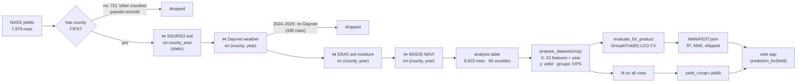

The join funnel with exact counts, computed from the processed CSVs by
`make_figures.py`:

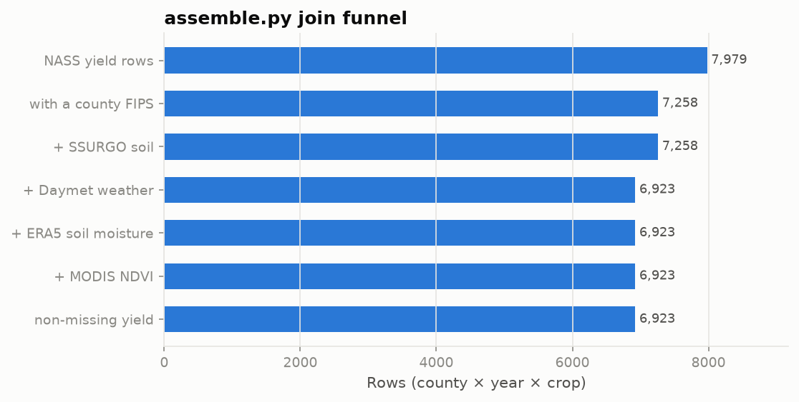

### 4.2 Build-time execution (`scripts/build_models.py`)

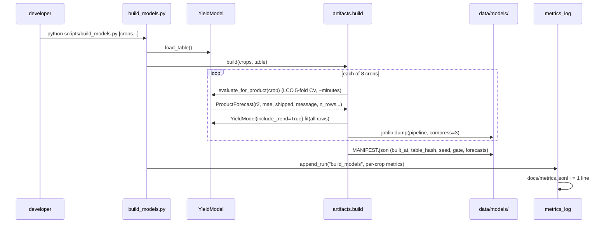

### 4.3 Request-time execution (field page)

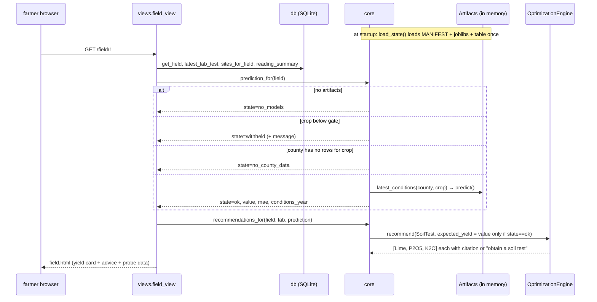

### 4.4 Write paths (POST → validate → redirect)

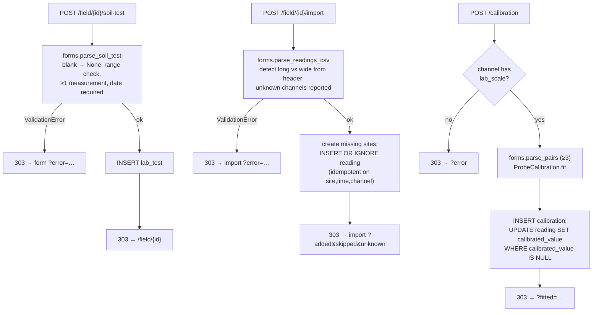

### 4.5 The research run (`python -m strata.main`)

`main.py` runs in this order: soil classifier (5-fold stratified CV + majority
baseline) → yield model for corn (baseline, attribution LCO, forecast LCO, forward
with and without trend) → product gate on four representative crops → recommender
on Chester County soil, with a corn yield predicted at 2023 conditions and passed
in as the removal basis only because corn cleared the gate → synthetic calibration
demo → summary built from this run's numbers → `append_run("main", ...)`. It
cross-validates live on purpose: its claim is that the numbers come from a real
run, not a cached file.

---

## 5. Data layer

### 5.1 Sources

| # | Source | Loader | Grain | What is kept | Output CSV |
|---|---|---|---|---|---|
| 1 | USDA NASS Quick Stats (API key) | `NASSYieldLoader` | county × year × crop | 8 yield series, SURVEY, 2000+ | `nass_pa_yields.csv` |
| 2 | SSURGO via Soil Data Access | `SsurgoSoilLoader` | county (static) | 0–25 cm area×component×depth-weighted sand/silt/clay/pH/OM/CEC; dominant order & drainage | `ssurgo_pa_soil.csv` (67 rows) |
| 3 | KSSL lab pedons via SDA | `KSSLPedonLoader` | horizon | texture, pH, CEC (NH₄OAc→sum-of-cations fallback), organic C, taxonomy labels; 14 NE states | `kssl_pedons.csv` (65,791 rows) |
| 4 | Daymet v4 single-pixel | `DaymetWeatherLoader` | county × year | Apr–Oct GDD, precip, Tmax/Tmin, heat days; per-window stats; Hargreaves water balance | `daymet_pa_weather.csv` (1,608 rows) |
| 5 | Open-Meteo Archive (ERA5-Land) | `OpenMeteoSoilLoader` | county × year | 7–28 cm soil moisture, season + window means | `openmeteo_pa_soilmoisture.csv` |
| 6 | MODIS MOD13Q1 via Earth Engine | `NDVICropLoader` | county × year | cropland-masked NDVI Apr–May / Jun / Jul (gated ≤ July) | `ndvi_pa.csv` |
| — | SSURGO polygons | `SsurgoSoilLoader.county_centroids` | county | area-weighted centroid for point APIs | `pa_county_centroids.csv` |
| — | Penn State AASL / Agronomy Guide | encoded in `recommender.py` | rule | thresholds + removal coefficients | — |

All query parameters live in `config/sources.yaml`. Secrets (`NASS_API_KEY`,
`EE_PROJECT`) come from `.env`. All HTTPS goes through `build_session()`, which
validates TLS against the OS trust store (`truststore`), not certifi. This is
needed on machines where antivirus software re-signs HTTPS traffic. Verification
is never disabled.

### 5.2 Joining grains (`assemble.py`)

Every join is an **inner** join, and each one logs rows in, rows out, and why rows
were dropped. County FIPS is always read as a string, because `"001"` read as an
integer silently fails to match. Joint SSURGO survey areas (5 in PA, e.g. PA605
Juniata+Mifflin) emit one row per constituent county using SSURGO's `laoverlap`
table. Deriving FIPS by slicing the areasymbol fabricated codes like `605` and
dropped 10 counties until 2026-07-25. Three tests now guard against that
regression.

### 5.3 The analysis table

One row = `(crop, county_ansi, year)` + unit + yield + 8 soil columns + 13 weather
columns + 5 water-balance columns + 5 soil-moisture columns + 3 NDVI columns.
Identifier columns (`county_ansi`, `county_name`, `areasymbol`) are carried for
traceability only. `yield_model.py` selects feature columns explicitly and never
uses them. Coverage: 6,923 rows, 66 counties, 2000–2023. Barley, hay, and alfalfa
series thin out after 2015, 2008, and 2018 respectively.

---

## 6. Models and training pipeline

### 6.1 Yield model (`yield_model.YieldModel`)

**Data.** `prepare_dataset(crop, table)` slices one crop, drops NaN targets, and
returns `X` (features + `year`), `y` (yield in that crop's own unit), and `groups`
(county FIPS). There is one model per crop because units differ (bu/ac vs tons/ac)
by an order of magnitude.

**Features (23 + trend).**

| group | columns | varies within a county over time? |
|---|---|---|
| soil numeric (6) | `topsoil_{sand,silt,clay}_pct`, `topsoil_ph`, `topsoil_om_pct`, `topsoil_cec` | no (static) |
| soil categorical (2) | `dominant_taxorder`, `dominant_drainage` (one-hot) | no |
| season weather (5) | `gdd_base10`, `precip_total_mm`, `tmax_mean_c`, `tmin_mean_c`, `heat_days_30c` | yes |
| window weather (8) | `precip_{aprmay,jun,jul,augoct}_mm`, `heat_days_{aprmay,jun,jul,augoct}` | yes |
| NDVI (2) | `ndvi_jun`, `ndvi_jul` (time-gated ≤ July) | yes |
| trend (1) | `year` (forecast mode only) | yes |

Assembled but **deliberately not used**: per-window GDD/Tmax/Tmin (collinear),
water balance and ERA5 soil moisture (tested null, §7.4), and `ndvi_aprmay`
(pre-emergence noise).

**Pipeline.**

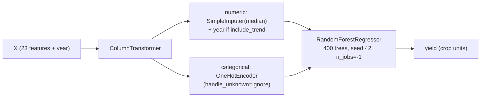

Imputation lives inside the pipeline, so it is fit per training fold. The
`include_trend` flag switches between **attribution mode** (`year` withheld: how
much do soil and weather explain alone?) and **forecast mode** (`year` included:
the product default, which captures the ~1.5–2 bu/ac/yr genetic and management
trend). `remainder="drop"` lets one prepared `X` serve both modes.

**Evaluation protocols** (all in `YieldModel`):

| method | splitter | answers |
|---|---|---|
| `cross_validate_random` | shuffled `KFold(5)` | optimistic upper bound (county fingerprint leaks) |
| `cross_validate_by_county` | `GroupKFold(5)` on FIPS | **the honest number**: a county never seen in training |
| `forward_forecast(cutoff=2017)` | train ≤2017 / test 2018+ | the arrow-of-time test a real season faces |
| `permutation_importance_cv` | per-fold permutation on raw columns | what the model relies on, random vs LCO |

**Product gate.** `evaluate_for_product(crop)` runs one LCO CV and returns a frozen
`ProductForecast(crop, forecast_r2, threshold, shipped, message, forecast_mae,
unit, n_rows, n_counties)`. `shipped = r2 ≥ PRODUCT_MIN_FORECAST_R2 (0.30)`. The
build step then fits the pipeline on **all** rows for serving. The metric that
travels with the model is always the held-out LCO number, never a training score.

**Inference.** `artifacts.latest_conditions(county, crop)` returns the county's
most recent observed row. Today that is 2023, because Daymet coverage ends there.
`Artifacts.predict` returns `None` for a withheld crop, so a caller cannot display a
forecast the gate refused. The app labels the result as county-scale and names the
conditions year. It is "what this county yields under recent conditions," not a
forecast of an unobserved season.

### 6.2 Soil classifier (`soil_classifier.SoilClassifier`)

**Data.** KSSL horizons → `engineer_pedon_features` collapses each pedon into one row.

| group | features |
|---|---|
| surface 0–25 cm (depth-weighted) | `surf_sand`, `surf_silt`, `surf_clay`, `surf_ph`, `surf_cec`, `surf_oc` |
| whole profile (depth-weighted) | `prof_sand`, `prof_silt`, `prof_clay`, `prof_ph`, `prof_cec`, `prof_oc` |
| diagnostic contrasts | `clay_max`, `clay_increase` (argillic signal), `ph_min`, `ph_max`, `oc_max`, `solum_depth`, `n_horizons` |

Target: Soil Taxonomy order (7 classes). Aridisols, vertisols, and oxisols (25
pedons) are dropped as too rare to validate. `lat`/`lon` and finer taxonomy labels
are excluded as leakage.

**Model.** `SimpleImputer(median)` → `RandomForestClassifier(400, class_weight="balanced", seed 42)`.
Evaluated with `StratifiedKFold(5)` on accuracy and macro-F1, against a
most-frequent baseline.

### 6.3 Recommendation engine (`recommender.OptimizationEngine`), not learned

`recommend(SoilTest, expected_yield=None)` runs three rules in a fixed order and
returns `Recommendation(category, severity, measured, finding, action, amount,
citation)`:

| rule | input | thresholds | refuses when |
|---|---|---|---|
| Lime | water pH, buffer pH | target 6.0; legumes (`hay`, `alfalfa`) 6.6; rate ≈ `(6.8 − buffer)/0.5 × 2` t/ac, cap 6 | no pH → no item; no buffer pH → "lime needed" with **no tonnage** |
| Phosphate | Mehlich-3 P | <30 deficient · 30–50 maintenance · 50–200 none · >200 environmental | P missing → "obtain a soil test" |
| Potash | Mehlich-3 K | <100 deficient · 100–130 maintenance · >130 none | K missing → "obtain a soil test" |

Maintenance rates use removal coefficients for corn grain (0.37 lb P₂O₅, 0.27 lb
K₂O per bu) and soybean (0.80 / 1.30). The basis is chosen in this order: the model's
predicted yield (only passed when the crop cleared the gate), then the farmer's
yield goal, then no rate at all. The printed rate names which basis it used. A
predicted yield never unlocks a missing soil test.

### 6.4 Calibration (`calibration.ProbeCalibration`)

`fit(property, probe, lab, units, synthetic)` fits OLS `lab = slope·probe + intercept`
(≥3 pairs, 1-D, equal length) and records `CalibrationFit(n, slope, intercept, r2,
rmse, mean_bias, synthetic)`. `apply(property, reading)` maps a raw value onto the
lab scale. A straight line is deliberate: with the handful of pairs a farmer
realistically collects, anything more flexible would overfit. The `synthetic` flag
travels with every fit so demo fits can never pass as findings.

---

## 7. Evaluation

### 7.1 Current metrics (logged runs, 2026-09-19, commit `9d5a69e` + uncommitted doc tooling)

**Yield, per crop, leave-counties-out forecast mode** (`build_models`):

| crop | LCO R² | MAE | unit | rows | counties | gate |
|---|--:|--:|---|--:|--:|:--|
| corn grain | 0.610 | 13.53 | bu/ac | 1,314 | 66 | ship |
| soybean | 0.586 | 4.01 | bu/ac | 1,033 | 57 | ship |
| corn silage | 0.554 | 1.83 | t/ac | 1,044 | 66 | ship |
| hay | 0.493 | 0.25 | t/ac | 567 | 66 | ship |
| barley | 0.388 | 6.74 | bu/ac | 366 | 35 | ship |
| winter wheat | 0.312 | 6.56 | bu/ac | 667 | 54 | ship |
| alfalfa hay | 0.268 | 0.38 | t/ac | 843 | 66 | **withhold** |
| oats | 0.142 | 6.36 | bu/ac | 1,089 | 61 | **withhold** |

This run reproduced the 2026-08-31 `MANIFEST.json` to four decimals, which
confirms that the build is deterministic.

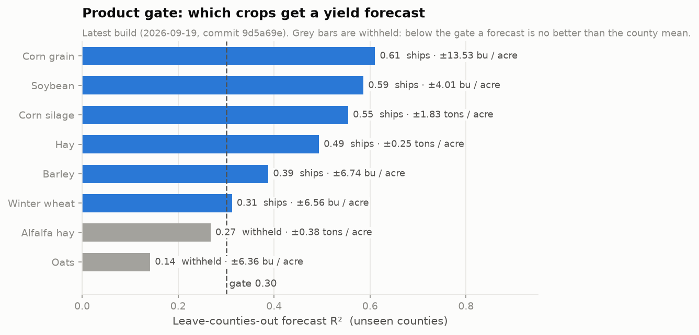

**Corn grain, the full ladder** (`main`):

| evaluation | R² | MAE (bu/ac) |
|---|--:|--:|
| mean-yield baseline (held-out 25%) | ≈ 0 | 22.8 |
| attribution, LCO (no `year`) | 0.525 | — |
| **forecast, LCO** | **0.610** | **13.5** |
| forecast, forward-in-time (train ≤2017) | 0.461 | 14.6 |
| forward-in-time **without** trend | 0.086 | — |

**Soil classifier** (`main`): 5-fold stratified accuracy **0.689**, macro-F1
**0.653**, majority baseline **0.341**, 7,686 pedons. Earlier runs found
`clay_increase` and `clay_max` to be the top permutation features; that is the
argillic-horizon signal Soil Taxonomy itself keys on.

**Worked example** (`main`, Chester County corn at 2023 conditions, illustrative
lab P 22 / K 85 / buffer pH 6.5): predicted 179 bu/ac. The engine returns lime
~1.2 t/ac (estimate), P₂O₅ ~66 lb/ac + build-up, and K₂O ~48 lb/ac + build-up.
Each rate is labeled "predicted yield (YieldModel)".

### 7.2 Comparison across versions

`docs/metrics.jsonl` holds one line per evaluation. The first five lines are
**backfilled** from earlier docs (hollow markers). Every line after them was
written by a run (filled markers).

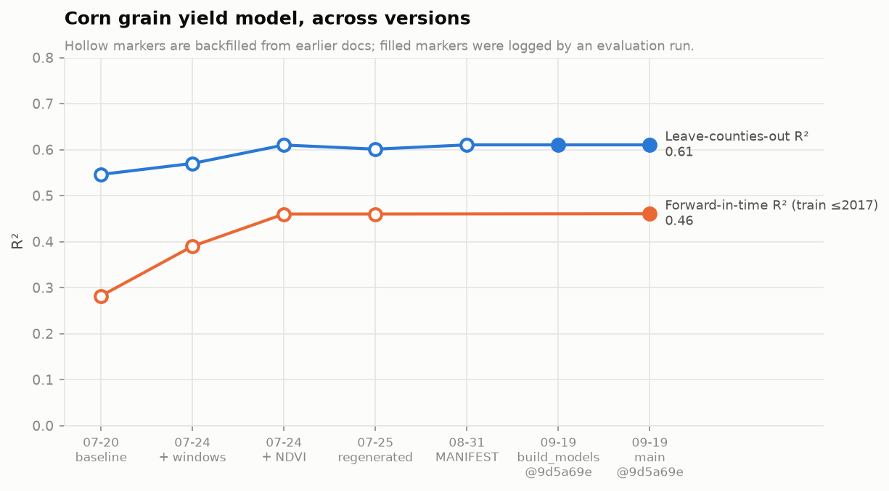

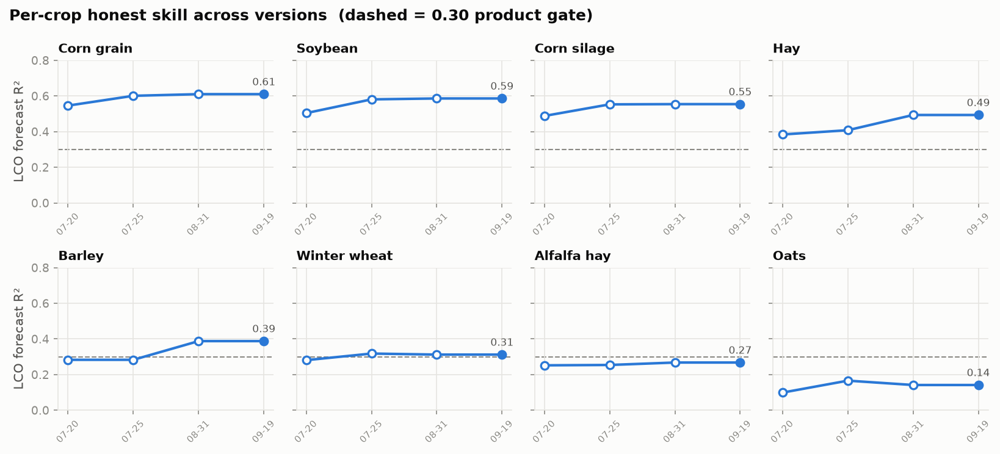

| version | change | corn LCO R² | corn forward R² | source |
|---|---|--:|--:|---|
| 2026-07-20 | soil + season weather, 66 counties (post SSURGO fix) | 0.546 | 0.282 | backfill |
| 2026-07-24 | + sub-season weather windows (precip, heat days) | 0.57 | 0.39 | backfill |
| 2026-07-24 | + MODIS NDVI Jun+Jul | 0.61 | 0.46 | backfill |
| 2026-07-25 | full regeneration on the shipped matrix | 0.601 | 0.46 | backfill |
| 2026-08-31 | serving build (`MANIFEST.json`) | 0.610 | — | backfill |
| 2026-09-19 | first logged `build_models` + `main` runs | **0.610** | **0.461** | run |

The attribution-mode number has moved too. It was 0.29 before the time-varying
features and is 0.525 now, because NDVI and weather windows explain much of what
`year` used to stand in for. This is also why the no-trend forward forecast rose
from −0.44 to +0.09.

### 7.3 Why the ceiling is where it is

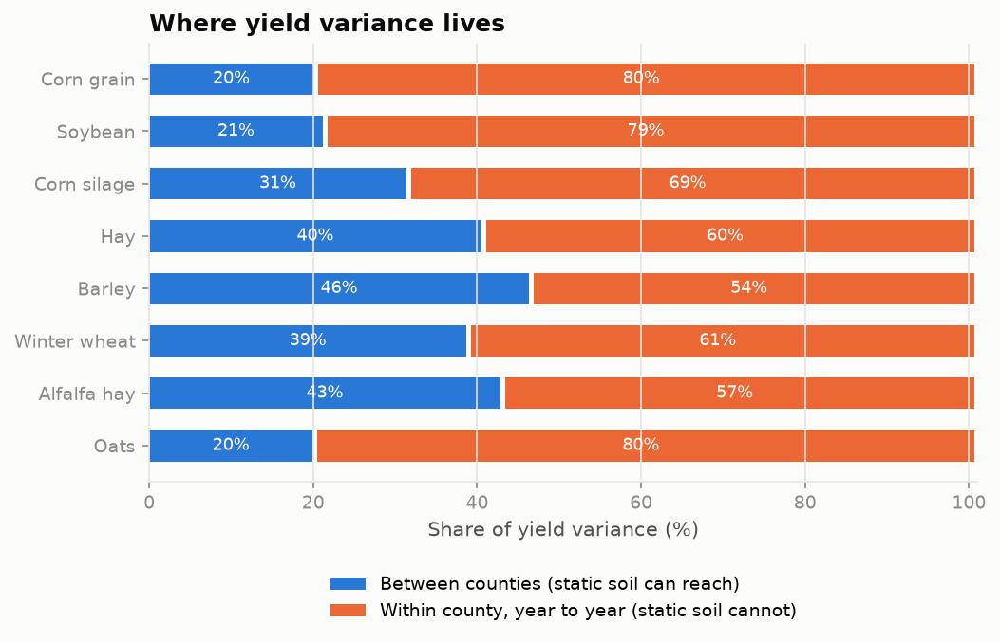

For corn grain, 20% of yield variance lies between counties and 80% within a
county from year to year. The 8 SSURGO features have zero within-county variance
(`test_soil_columns_are_static_within_a_county`), so they can only address the 20%.
Gains therefore had to come from features that vary within a county over time.
That prediction was tested and held: weather timing and NDVI lifted forward R² from
0.28 to 0.46.

### 7.4 Negative results (tested, rejected, kept on record)

| tried | result | why it was rejected |
|---|---|---|
| gradient boosting, ExtraTrees, hyperparameter tuning | no forward-R² gain; ExtraTrees raised LCO but *lowered* forward | an LCO gain that does not hold forward is not a real improvement |
| county lat/lon as features | no gain | identity proxy |
| engineered weather × soil interactions | no gain | — |
| explicit linear detrend + RF on residuals | corn forward 0.35 → 0.29 | the linear trend overshoots 2018+ |
| per-window mean temperature / GDD | forward fell back to 0.28 | collinear with season means |
| Hargreaves water balance | ≈ 0 | derived from the same precip and temperature |
| ERA5-Land root-zone soil moisture | ≈ 0; *hurt* winter wheat | reanalysis of the same meteorology |
| NDVI Apr–May window | forward noise | bare soil before emergence |

The two null results sharpen the argument for the probe. Free gridded soil
proxies plateau because they are all meteorology-derived. A probe measures real
field soil water and biology, which is independent of county-mean weather.

### 7.5 Test suite as evaluation of invariants

`python -m pytest` runs 95 tests in about 80 s. All passed on 2026-09-19. Data-backed
tests skip when `data/processed/` is absent.

| file | invariants |
|---|---|
| `test_join_integrity.py` | 67 soil rows, no fabricated FIPS, joint areas → one row per county, 66 modeling counties, no duplicate keys, soil static within county |
| `test_feature_contracts.py` | `assemble` and `yield_model` feature lists agree; no county identity, no target statistic, NDVI ≤ July, no `year` in attribution mode, no lat/lon or taxonomy in the classifier, gate is a named constant |
| `test_recommender_honesty.py` | no P/K without a lab test, no lime rate without buffer pH, predicted yield never unlocks a missing test, citation on every item, excessive P flagged |
| `test_calibration.py` | recovers a known line, round-trips, reports bias, carries `synthetic`, refuses <3 pairs / mismatched / unfitted |
| `test_probe_placeholder.py` | registry matches bought hardware; no-lab-scale channels never reach rules; CO₂ and N never recommendation inputs; conversions still raise; `main.py` does not import `probe` |
| `test_web_app.py` | every page renders; 404 not crash; withheld shows no number; no advice without a lab test; county-scale caveat; synthetic/uncalibrated marked; model card lists withheld crops; raw crop keys never leak; provenance footer |
| `test_web_forms.py` | blank ≠ zero end to end; range and date checks; long/wide CSV equivalence; unknown channels reported; idempotent import; calibration never overwrites; field county/crop validated |

---

## 8. Module-by-module reference

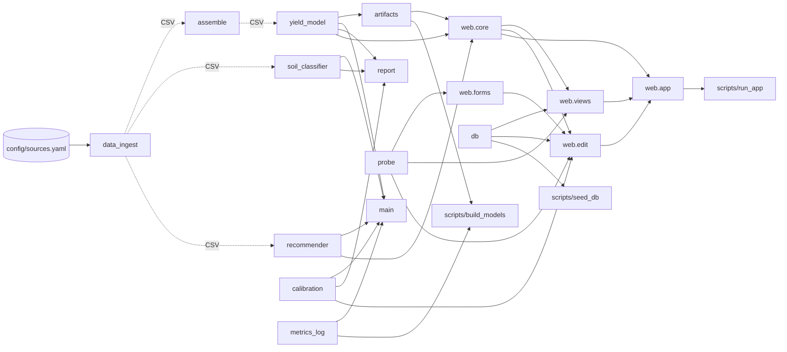

Solid arrows are Python imports; dotted arrows are file handoffs.

### 8.1 `src/strata/data_ingest.py` (1,513 lines)

**Purpose.** Source-agnostic loaders that pull public data and write tidy,
documented CSVs. This module is the only network code in the analysis pipeline.

| symbol | role |
|---|---|
| `load_source_config(path)` | parse `config/sources.yaml` (no I/O beyond the file) |
| `_SystemTrustAdapter`, `build_session(use_system_trust_store)` | `requests.Session` that validates TLS against the OS trust store |
| `DataSource` (ABC) | contract `fetch()` → `tidy()` → `load()`, with row-count and missingness logging and a per-class `SCHEMA` |
| `NASSYieldLoader(query_name)` | `build_params`, `build_query_url` (key redacted), `fetch`, `tidy` (suppression markers → NaN), `load_crops([...])` |
| `SsurgoSoilLoader(areasymbol)` | two SDA SQL queries; `tidy` depth-weights horizons → components → area×comppct county summary; `list_pa_areas`, `area_county_map` (laoverlap), `county_centroids`, `load_areas` |
| `KSSLPedonLoader(state_code)` | lab_* join per state; coalesces taxonomy labels, OC and CEC fallbacks; `load_region` |
| `DaymetWeatherLoader(county, lat, lon)` | single-pixel CSV → GDD, heat flag, Hargreaves PET, water balance → season + config windows; `load_counties` |
| `OpenMeteoSoilLoader(county, lat, lon)` | hourly soil moisture with 429-aware backoff (minute vs hour budget) → season + window means; `load_counties` |
| `NDVICropLoader()` | Earth Engine `reduceRegions` per year over PA counties with CDL cropland mask; `load_all` |

**Inputs:** network, `.env` (`NASS_API_KEY`, `EE_PROJECT`), `config/sources.yaml`.
**Outputs:** `data/processed/{nass_pa_yields, ssurgo_pa_soil, kssl_pedons, daymet_pa_weather, openmeteo_pa_soilmoisture, ndvi_pa, pa_county_centroids}.csv`.
The `__main__` block pulls only the NASS crops; the other sources are driven by
their classmethods.
**Depended on by:** nothing imports it. `assemble`, `soil_classifier`,
`recommender`, and `seed_db` read its CSVs.

### 8.2 `src/strata/assemble.py`

**Purpose.** Join the processed CSVs into the analysis table, logging every drop.
**Key:** `build_analysis_table(nass, soil, weather, soilmoist, ndvi, drop_suppressed, include_soilmoist, include_ndvi)`.
It performs one static join and then loops over the three `(county, year)` joins.
The `_SOIL_FEATURES`, `_WEATHER_FEATURES`, `_DROUGHT_FEATURES`,
`_SOILMOIST_FEATURES`, and `_NDVI_FEATURES` lists are kept in sync with
`YieldModel` by `test_feature_contracts`. `_report(df)` prints coverage.
**Inputs:** five processed CSVs. **Output:** `analysis_county_year.csv` (when run as `__main__`).
**Depended on by:** `tests/test_feature_contracts.py` (feature lists); downstream modules through the CSV.

### 8.3 `src/strata/yield_model.py`

**Purpose.** Per-crop yield regression, honest evaluation, and the product gate.
**Key:** `YieldModel(n_estimators=400, random_state=42, include_trend=True)` with
`load_table`, `prepare_dataset`, `fit`, `predict`, `cross_validate_random`,
`cross_validate_by_county`, `forward_forecast`, and `evaluate_for_product`;
`ProductForecast` (frozen dataclass); `permutation_importance_cv`; constants
`FEATURES`, `TREND_FEATURE`, `TARGET`, `GROUP`, `PRODUCT_MIN_FORECAST_R2 = 0.30`.
**Inputs:** `analysis_county_year.csv`. **Outputs:** fitted pipelines, metric dicts, `ProductForecast`.
The `__main__` block prints random vs LCO CV, permutation importance, and the all-crop table.
**Depended on by:** `artifacts`, `main`, `report`, `web.core`, `web.views`, tests.

### 8.4 `src/strata/soil_classifier.py`

**Purpose.** Show that soil order is recoverable from measurable lab properties.
**Key:** `SoilClassifier` with `load_pedons`, `_wmean`, `engineer_pedon_features`,
`prepare_dataset`, `fit`, `predict`, `cross_validate`; `FEATURES` (19),
`RARE_ORDERS`.
**Inputs:** `kssl_pedons.csv`. **Outputs:** CV dict; a classification report,
confusion matrix, and permutation importance under `__main__`.
**Depended on by:** `main`, `report`, `test_feature_contracts`.

### 8.5 `src/strata/recommender.py`

**Purpose.** A cited Penn State rule engine for lime, P, and K.
**Key:** `Citation`, `CITATIONS` (5 entries), `SoilTest` (inputs; lab-only fields
may be `None`), `Recommendation`, `OptimizationEngine` (named threshold constants,
`REMOVAL`, `target_ph`, `_lime_rule`, `_lime_rate_from_buffer`,
`_phosphorus_rule`, `_potassium_rule`, `_maintenance_rate`, `recommend`),
`soiltest_from_ssurgo`, `_print_report`.
**Inputs:** a `SoilTest` and an optional expected yield. **Outputs:** an ordered `list[Recommendation]`.
**Depended on by:** `main`, `web.core`, `test_recommender_honesty`.

### 8.6 `src/strata/calibration.py`

**Purpose.** The single seam where probe readings become lab-equivalent values.
**Key:** `CalibrationFit` (frozen), `ProbeCalibration.fit` / `.apply`, `_print_fit`.
**Inputs:** paired arrays. **Outputs:** a fit record and mapped values.
**Depended on by:** `main`, `report`, `web.edit`, `test_calibration`.

### 8.7 `src/strata/probe.py` (placeholder)

**Purpose.** Write down the sensor→software contract for the acquired hardware
before its output format is known.
**Key:** `Channel(name, sensor, units, lab_scale, destination, note)`; `CHANNELS`
has 7 entries (see §12); `RECOMMENDER_CHANNELS` (`ph`, `phosphorus`, `potassium`);
`ProbeReading(site_id, taken_at, values, lat, lon, device_id, calibrated)` with
`unknown_channels()`. `parse_device_output`, `readings_to_soiltest`, and
`readings_to_features` all **raise `NotImplementedError`** and name the question
each one is blocked on.
**Depended on by:** `web.forms` (CSV channel validation), `web.views`, `web.edit`
(channel metadata, calibratability), `test_probe_placeholder`. It is not used by
`main`.

### 8.8 `src/strata/artifacts.py`

**Purpose.** Fit once, serve everywhere, and detect when served models are stale.
**Key:** `BUILD_CROPS` (8), `MODEL_DIR`, `_table_hash` (sha256[:16] of the table),
`Manifest`, `Artifacts` (`load`, `is_stale`, `shipped_crops`, `predict` → `None`
when withheld), `latest_conditions`, `build`.
**Inputs:** the analysis table. **Outputs:** `data/models/yield_<crop>.joblib`
(compress=3) and `MANIFEST.json`.
**Depended on by:** `scripts/build_models.py`, `web.core`.

### 8.9 `src/strata/db.py`

**Purpose.** SQLite persistence for the app: a single farm per instance, stdlib
`sqlite3`, no ORM.
**Key:** `DB_PATH`, `SCHEMA`, `connect`, `init_db`, and the read helpers
`get_fields`, `get_field`, `latest_lab_test` (most recent, never merged),
`sites_for_field`, `readings_for_site` (oldest first), and `reading_summary`
(with an `n_uncalibrated` column).

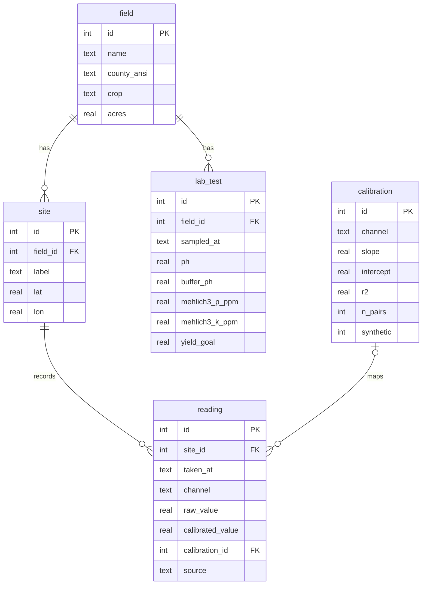

`reading` is long (one row per site × time × channel), with
`UNIQUE(site_id, taken_at, channel)`. `source` ∈ {`device`, `import`, `synthetic`}.
**Depended on by:** `web.views`, `web.edit`, `scripts/seed_db.py`, web tests.

### 8.10 `src/strata/metrics_log.py` (new)

**Purpose.** Append one JSON line per evaluation run to `docs/metrics.jsonl`.
**Key:** `append_run(kind, metrics, note=None)` records `timestamp`, `commit`,
`dirty`, `kind`, `source="run"`, and `metrics`. Git failures are recorded as `None`
and never raise.
**Depended on by:** `main`, `scripts/build_models.py`, and indirectly `docs/scripts/make_figures.py` (reads the file).

### 8.11 `src/strata/main.py`

**Purpose.** The offline research report, with live cross-validation.
**Key:** `section_soil_classifier` → dict, `section_yield_model` → dict,
`_product_skills` (gate on `_GATE_CROPS`), `section_product_gate`,
`section_recommender` (gated model→engine handoff), `section_calibration`
(synthetic), and `main` (runs all sections, prints a summary built from this run,
then calls `append_run`).
**Run:** `PYTHONPATH=src python -m strata.main` (~4 min).

### 8.12 `src/strata/report.py`

**Purpose.** A 4-panel diagnostic PNG: LCO predicted vs actual; the accuracy
ladder; the normalized soil confusion matrix; the synthetic calibration fit.
**Key:** `build_dashboard(out, crop)`. **Output:** `data/processed/strata_dashboard.png`.
It recomputes its own CV rather than reading artifacts.

### 8.13 `src/strata/web/` (see §9)

| file | purpose | key symbols |
|---|---|---|
| `app.py` | assembly only: lifespan loads state, mounts static, includes routers | `app`, `lifespan` |
| `core.py` | shared state, templates, domain helpers | `STATE`, `load_state`, `CROP_LABELS`, `crop_label` (longest key first), `base_context`, `not_found`, `soiltest_from_lab`, `prediction_for`, `recommendations_for`, `sparkline`, `pa_counties`, `modelled_crops` |
| `views.py` | read routes | `index`, `field_view`, `site_view`, `models_view` |
| `edit.py` | write routes (POST → 303) | `_back`, `soil_test_form/submit`, `import_form/submit`, `calibration_view/submit`, `field_new_form`, `field_edit_form`, `field_create`, `field_update`, `site_create` |
| `forms.py` | validation encoding the honesty rules | `ValidationError`, `optional_float`, `required_date`, `clean_text`, `SOIL_TEST_FIELDS`, `parse_soil_test`, `ImportResult`, `parse_readings_csv`, `parse_pairs`, `parse_field`, `parse_site` |
| `templates/*.html` | 10 Jinja templates: base, index, field, field_form, site, soil_test, import, calibration, models, notfound | — |
| `static/strata.css` | the only stylesheet; no JS, no build step | — |

### 8.14 Scripts, config, tests

| file | purpose |
|---|---|
| `scripts/build_models.py` | fit and evaluate crops → `data/models/`; prints the gate table; logs metrics |
| `scripts/seed_db.py` | creates `data/strata.db` with "North Field" (corn, real Chester pH/CEC/OM, demo P/K, 3 sites, 252 synthetic readings) and "Back Lot" (oats, no lab test: exercises WITHHELD + NEEDS LAB TEST); `--reset` |
| `scripts/run_app.py` | uvicorn launcher (`--host`, `--port`, `--reload`) |
| `scripts/ee_authenticate.py` | one-time Earth Engine OAuth with `truststore` injected |
| `config/sources.yaml` | every endpoint, query, date range, window, and state list |
| `tests/conftest.py` | session fixtures that skip when processed CSVs are absent |
| `docs/scripts/make_figures.py` | regenerates all figures in this report |
| `.claude/hooks/*.py` | documentation-sync hooks (§13) |

---

## 9. The web application

**Stack.** FastAPI + Jinja2 + SQLite, server-rendered, plain HTML forms, no
JavaScript, no npm. Models are loaded once at startup. A missing build degrades to
a "no models built" banner; a stale build (table hash mismatch) or a scikit-learn
version mismatch each show a warning banner. Every page footer names the build
date, row count, table hash, gate, and seed. The `?details=true` toggle reveals
developer detail (R², n, sensor names, raw crop keys) and doubles as the
prototyping view.

**Shell.** A persistent sidebar splits the app by audience: **Farm** (Overview,
Fields) is the grower's surface, **Lab** (Calibration, Models) is the team's
research instrument. Under 900px the sidebar becomes a drawer behind a hamburger,
driven by a CSS `:checked` selector rather than JavaScript, so the layout keeps
working with no script. The active item is derived from the request path in
`core.base_context`, so a new page cannot forget to highlight itself.

| route | method | does |
|---|---|---|
| `/` | GET | **Overview**: per-field soil status cards plus an attention list |
| `/fields` | GET | field list |
| `/field/{id}` | GET | yield card, cited advice, probe channel summary, sites |
| `/field/{id}/season?channel=&year=` | GET | **season view**: one channel across every spot, over one growing season |
| `/field/{id}/map?channel=` | GET | **field map**: sampling spots in real coordinate space, shaded by latest reading |
| `/field/{id}/readings/delete` | POST | remove readings scoped by channel / day / source |
| `/field/{id}/soil-test/{tid}/delete`, `/field/{id}/site/{sid}/delete`, `/field/{id}/delete` | POST | delete a soil test, a spot, or a whole field (name typed back) |
| `/field/{id}/site/{sid}?channel=` | GET | one channel's time series (server-side SVG sparkline); defaults to a channel that site actually has |
| `/models` | GET | model card: every crop's skill and gate decision, withheld crops included |
| `/field/{id}/soil-test` | GET/POST | enter an AASL report |
| `/field/{id}/import` | GET/POST | CSV import (paste or upload; long or wide) |
| `/calibration` | GET/POST | fit a probe→lab line and apply it to uncalibrated readings |
| `/fields/new`, `/field/{id}/edit` | GET/POST | create or edit a field (county from SSURGO, crop from built models) |
| `/field/{id}/sites` | POST | add a site (coordinates optional) |

**The five honesty states** (enforced in code and tested):

| state | where enforced | shown when |
|---|---|---|
| WITHHELD | `core.prediction_for`, `Artifacts.predict` | crop below the 0.30 gate |
| NEEDS LAB TEST | `recommender` refusals, `forms.optional_float` (blank → `None`) | Mehlich-3 P/K absent |
| SYNTHETIC | `reading.source`, `CalibrationFit.synthetic`, "Demo values" tag | seeded or demo data |
| UNCALIBRATED | `reading.calibrated_value IS NULL`, `reading_summary.n_uncalibrated` | raw probe values with no mapping |
| COUNTY-SCALE | `field.html` yield card caveat | on every prediction |

### 9.1 Soil status, and why it is not a score

The Overview answers "how is each field doing?" — a question whose obvious UI is a
single number, and whose obvious number is indefensible. `recommender.CITATIONS`
covers three measures (pH via lime, Mehlich-3 P, Mehlich-3 K). Combining them with
organic matter and biology into a 0–100 figure needs weights no Penn State
publication supplies, and this project already deleted one circular scorer.

`web/status.py` therefore produces a **status**, not a score:

- Each chip is one finding from the audited rule engine, carrying the citation it
  came from. Nothing is combined that the agronomy does not combine.
- **CEC and organic matter are shown as context labelled "no rule"**, visibly
  outside the judgement. Organic matter is the classic soil-health indicator, so
  its exclusion is deliberate and stated: there is no citation for it in this
  codebase. Adding one is a research task, and until then OM cannot carry weight.
- Soil CO₂ — the project's differentiator — likewise has no AASL threshold, and is
  a trend only.
- The four states are `unmeasured`, `attention`, `partial`, `ok`. **`unmeasured`
  is not `ok`**: a field with no soil test is unknown, not healthy, and it takes
  the same amber as a deficiency. `unknown` findings are counted separately and
  never average away against good ones.
- `environmental` outranks `deficiency` in the headline, because excess P is a
  runoff and P-Index concern for the Chesapeake watershed rather than only a
  yield question.

The attention list (`status.alerts_for`) deliberately mixes "you should act" with
"we cannot tell you". A dashboard listing only actions would imply an unmeasured
field is a fine one.

### 9.2 The season view

`/field/{id}/season` plots one channel across every spot in a field over one
growing season. It is the farmer-facing picture of the argument this whole project
rests on: a measurement that varies **within a field** and **within a season** —
the two axes the static county soil snapshot does not have, and the reason the
yield model hits the ceiling in §7.

**The bands are the model's own windows.** Behind the readings sit the four
sub-season phenology windows from `config/sources.yaml` → `daymet.season_windows`,
the same windows `assemble.py` turns into per-window precipitation and heat-day
features. July (silking) is drawn slightly darker because it is the window the
corn model leans on hardest. This is the one screen where the grower and the yield
model are visibly reading the same calendar.

**Geometry** (`web/charts.py`) is pure arithmetic returning SVG coordinates, so it
is unit-tested without rendering (`tests/test_charts.py`, 15 tests). The x domain
is the growing season **unioned** with the data's own range: a fixed frame keeps
seasons comparable and keeps the bands anchored to the real calendar, while a
reading taken outside Apr–Oct is still plotted rather than silently dropped.

**Colour is categorical, and strictly separated from the status palette.** A
series colour says *which spot*, not *how good*. Painting a site's line in the
app's amber would assert something about that site. The eight slots are a
published validated order, assigned in fixed sequence and never cycled; a ninth
spot is named as unplotted rather than reusing a hue that already means something.
Validated against this app's own surfaces: worst adjacent colourblind ΔE 9.1 light
/ 8.4 dark, normal-vision 19.6 / 19.3, all passing. **Light mode fails the 3:1
contrast check**, which is not dismissable — it obliges direct labels and a table
view, and the template ships both. An uncalibrated point is drawn hollow, so raw
and lab-equivalent readings are distinguishable without a second colour.

**Deviation worth recording.** Visualisation guidance calls for a JavaScript
crosshair and tooltip on line charts. This app has a documented no-script
property (§9, and the CSS-only nav drawer), so hover is served by SVG `<title>`,
which browsers render as a native tooltip with no script, and every chart ships
the full table view beside it. Data inspection is preserved; the interaction is
plainer than the guidance prefers.

### 9.3 The field map

`/field/{id}/map` places a field's sampling spots in **real coordinate space** and
shades each by its most recent reading of a chosen channel.

**A schematic, not a basemap.** No tiles, no API key, no script. It needs no
network and is honest about being a sketch of sampling geometry rather than a
picture of the farm.

**The projection is the part that has to be right.** Longitude is scaled by
cos(latitude) before projection: without it a Pennsylvania field renders about
23% too wide east-west, misplacing every spot relative to every other and
defeating the one job a farmer needs it for — walking back to a planted probe. A
single px/m scale is applied to both axes, so the sampling pattern is never
stretched; north is up; a scale bar carries the distance. Verified against the
seeded field: a 350 m true separation renders at 362 px against a 1.035 px/m
scale.

**It is explicitly not an interpolated surface, and the page says so.** Shading
three points and smoothing between them would be drawing, not measuring. The
template states how many further well-distributed spots a believable gradient
would need (`FieldMap.SURFACE_MIN_SITES`, currently 10) — and notes that making
many spots affordable is exactly the argument for the probe. The geometry is
projected properly so a surface layer can be added on top later without redoing
it.

**Colour encodes magnitude, so it takes a sequential ramp** — one hue,
light→dark — kept distinct from the categorical series order used by the season
chart, which encodes identity. The two share a blue hue by design but never
appear on the same chart, which is the invariant tested. A spot with no reading
for the selected channel renders hollow rather than at the palest step: *not
measured here* is not *lowest value here*.

### 9.4 Deletion

Every write path could create data and none could remove it, so a mistyped soil
test or an import of the wrong file was permanent short of opening SQLite. Each
delete is a **POST** (never a GET, which a browser prefetch or a crawler may
follow unbidden), is scoped as narrowly as the realistic mistake, and reports a
count afterwards so a surprising number is visible rather than silent.

| action | scope | guard |
|---|---|---|
| readings | channel and/or day and/or source, within one field | re-importing restores them exactly — import is idempotent |
| soil test | one test | — |
| spot | one spot, cascading to its readings | a reading with no spot has no location |
| field | everything beneath it | the field's name must be typed back |

The field delete requires the name because fields sit side by side on the
Overview with small rows, and a misclick would take a season of readings with it.
`tests/test_web_forms.py` asserts the scoping holds — in particular that deleting
one field's readings never crosses into another's, which a missing join clause
would otherwise do silently.

---

## 10. Design decisions

| decision | alternative rejected | reason |
|---|---|---|
| One RF per crop | a pooled multi-crop model | units and magnitudes differ; pooled R²/MAE would be meaningless |
| Leave-counties-out as the headline metric | random k-fold | static soil leaks county identity across folds (random 0.69 vs LCO 0.60 for corn) |
| `year` as an explicit, switchable trend | hide it, or detrend linearly | without it the forward forecast collapses; the linear detrend overshoots; both modes are reported |
| Named product gate at LCO R² 0.30 | ship every crop | a forecast no better than the county mean misleads; the constant is auditable and re-applied at every build |
| Rules, not a model, for fertility | learn P/K response from yields | a solved, regulated problem; learning it from county yields would be circular |
| Refuse rather than impute lab values | fill P/K from SSURGO or defaults | SSURGO has no Mehlich-3 P/K or buffer pH; zero-filling would assert a deficient soil |
| OLS calibration line | a flexible regressor | calibration sets are tiny; the fit reports R², RMSE, and raw bias |
| Build step + manifest + content hash | fit on request / cache silently | CV takes minutes; one artifact means every surface shows the same number; staleness is detected |
| Long `reading` table | one column per sensor | firmware adding a channel becomes a data change, not a migration |
| Separate `raw_value` / `calibrated_value`; never overwrite | recompute on refit | a number a farmer acted on must not change silently |
| Server-rendered, no JS | SPA | one language, no build step, works on a poor field connection |
| `truststore` OS trust | certifi / `verify=False` | works behind TLS-inspecting antivirus software without disabling verification |
| Placeholder probe conversions that raise | parse a guessed format | a guessed parser would invent data |
| Inner joins with logged drops | outer joins with fills | a training row needs target + soil + weather; every drop is visible |

---

## 11. Limitations

### 11.1 Structural

- **County scale.** Predictions describe a county under recent conditions, not a
  field. There is no field-level yield truth in the system.
- **Inference year.** Predictions use the latest observed conditions (2023). A true
  in-season forecast would need that season's weather and NDVI up to July.
- **Coarse soil.** One area-weighted summary per county. The 10 counties in joint
  survey areas share their soil summary and one Daymet/ERA5 centroid.
- **Weak crops.** Oats (0.14) and alfalfa (0.27) are withheld. Barley and hay
  series end in 2015 and 2008, so their skill is estimated on older years only.
- **Rule approximations.** The lime rate is a linear stand-in for the AASL
  buffer-pH table. Removal coefficients exist only for corn grain and soybean. All
  rates must be confirmed against a current AASL report.
- **Single farm per instance.** There are no users, tenants, or auth.

### 11.2 Operational

- The package is not pip-installed, so `python -m strata.…` needs `src` on
  `PYTHONPATH` (`PYTHONPATH=src`). README Setup, METHODS §13, and HOW-IT-WORKS
  now say so. Packaging with `pip install -e .` would remove the step.
- The processed data and models are gitignored. A fresh clone needs API keys and
  hours of pulls (Open-Meteo rate limits dominate) before data-backed tests and the
  app work.
- `report.py` recomputes CV instead of reading artifacts, so it takes minutes.

### 11.3 Documentation discrepancies (resolved 2026-09-19)

Writing this report surfaced four places where the docs disagreed with the code or
the current build. All four are now fixed; see the [CHANGELOG](CHANGELOG.md):

- The `METHODS.md` §6 and §10 results tables (from a 2026-07-25 run: hay 0.408,
  barley 0.283 **withheld**, corn 0.601) disagreed with the current build (hay 0.493,
  barley 0.388 **shipped**, corn 0.610). Both tables were regenerated from logged
  2026-09-19 runs. The 07-25 numbers came from an earlier state of the analysis
  table, and the exact change between the two runs was never recorded. That gap is
  why evaluation runs now log themselves to `metrics.jsonl`.
- A README bullet quoted oats 0.07 / alfalfa 0.18. It now quotes the current 0.14 / 0.27.
- The README, `METHODS.md`, `HOW-IT-WORKS.md`, `calibration.py`, and `main.py`
  said "no probe hardware exists." They now say the hardware exists but no
  *paired probe/lab data* has been collected yet. The software claim (no hardware
  dependency) is unchanged and still tested.
- `python -m strata.main` needing `PYTHONPATH=src` is now documented (§11.2).

---

## 12. Future work: landing the probe

The hardware is nearly ready, and the contract for it is already written in
`probe.py`. The acquired suite and its routing:

| channel | sensor | units | lab scale | destination | rule-engine eligible |
|---|---|---|---|---|:-:|
| `soil_moisture` | SEN0193 capacitive | vol % | — | yield_model | no |
| `soil_temp` | DS18B20 | °C | — | yield_model | no |
| `ph` | pH probe | pH | water pH (not buffer) | both | yes (trigger only, never a lime rate) |
| `nitrogen` | NPK sensor | mg/kg (device) | — (no PSNT) | yield_model | no |
| `phosphorus` | NPK sensor | mg/kg (device) | Mehlich-3 P (empirical, must earn it) | both | only after paired lab validation |
| `potassium` | NPK sensor | mg/kg (device) | Mehlich-3 K (empirical, must earn it) | both | only after paired lab validation |
| `co2` | SCD40 | ppm | — | yield_model | no |

**Integration path, in order:**

1. **Capture one real device output.** Record its serialization, field names,
   units, cadence, session delimiting, clock and timezone, and where location comes
   from. Then implement `probe.parse_device_output`. Until then, the existing CSV
   import (`/field/{id}/import`, long or wide) already accepts device dumps whose
   columns match `CHANNELS` names. Unknown columns are reported, not guessed at.
2. **Collect paired samples.** For each of pH, P, and K, pair field probe readings
   with AASL lab results from the same composite cores (≥3 pairs; realistically 10
   or more). Fit through `/calibration`. Decide on P/K eligibility from the honest R²,
   or demote those channels to yield-model-only. Moisture needs a per-soil
   gravimetric reference, not a lab equivalence.
3. **Implement `readings_to_soiltest`.** Choose and document how a logging session
   reduces to the single value a threshold rule expects. Buffer pH still requires
   the lab, so the lime *rate* refusal stays.
4. **Settle field vs county before `readings_to_features`.** Either (a) keep the
   county-year model and apply probe features as a documented field-level
   adjustment, or (b) move to a field-year model, which requires farmer-reported or
   combine-monitor yields. The choice must be written into METHODS before any number
   derived from it is reported.
5. **Measure it like everything else.** Log each experiment to
   `docs/metrics.jsonl`, A/B on LCO *and* forward splits, and ship only what improves
   the forward forecast.

Other future work: an in-season forecast mode (weather and NDVI to date), removal
coefficients for more crops, the AASL buffer table as a lookup instead of a linear
approximation, multi-farm support, and packaging (`pip install -e .`) to fix §11.2.

---

## 13. Keeping this report current

The documentation system has four parts:

| part | file | what it does |
|---|---|---|
| policy | `CLAUDE.md` → *Documentation policy* | this report is canonical; every code-changing prompt gets a changelog entry; update the diagrams and figures when behavior changes; read the code before describing it |
| changelog | [`docs/CHANGELOG.md`](CHANGELOG.md) | one entry per prompt: date, prompt, files, what and why, metrics before/after |
| metrics log | [`docs/metrics.jsonl`](metrics.jsonl) | one line per evaluation run, written by `strata.metrics_log.append_run` from `build_models.py` and `main.py`; backfilled rows are marked |
| figures | `docs/scripts/make_figures.py` → `docs/figures/` | gate chart, corn history, per-crop history, variance decomposition, join funnel |

**Hooks** (`.claude/settings.json`):

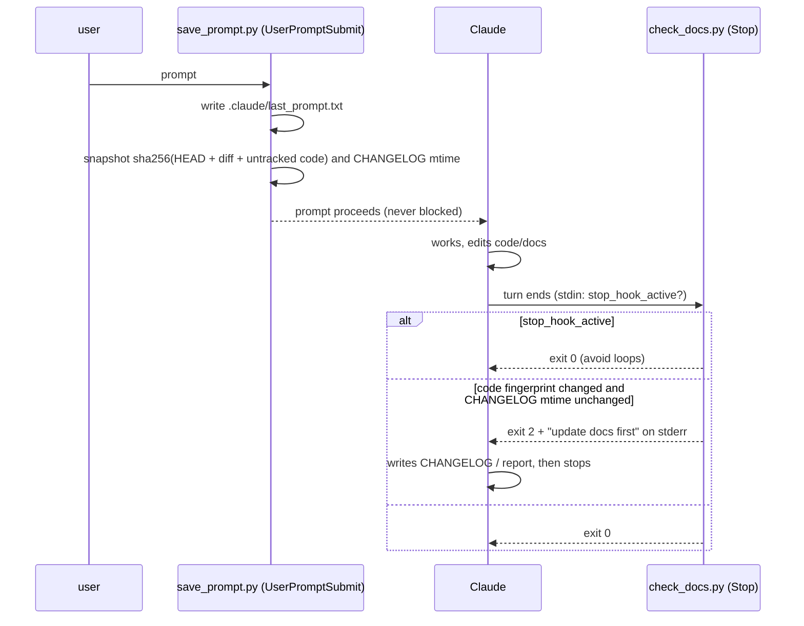

"Code" here means everything except `docs/`, `.claude/`, and `*.md`, so writing
documentation never counts as a code change. The snapshot state
(`.claude/last_prompt.txt`, `.claude/hooks/.turn_state.json`) is gitignored.

---

## Appendix: reproducing everything

```bash
# environment
python -m venv .venv && .venv\Scripts\activate      # Windows
pip install -r requirements.txt
cp .env.example .env                                  # NASS_API_KEY, EE_PROJECT

# data (network; see config/sources.yaml and data_ingest.py classmethods)
PYTHONPATH=src python -m strata.data_ingest           # NASS; other loaders via their load_* classmethods
PYTHONPATH=src python -m strata.assemble              # -> analysis_county_year.csv

# evaluation (each appends to docs/metrics.jsonl)
python scripts/build_models.py                        # ~minutes, -> data/models/
PYTHONPATH=src python -m strata.main                  # ~4 min, research report

# figures and tests
python docs/scripts/make_figures.py                   # -> docs/figures/*.png
python -m pytest                                      # 95 tests

# app
python scripts/seed_db.py && python scripts/run_app.py   # http://127.0.0.1:8000
```
